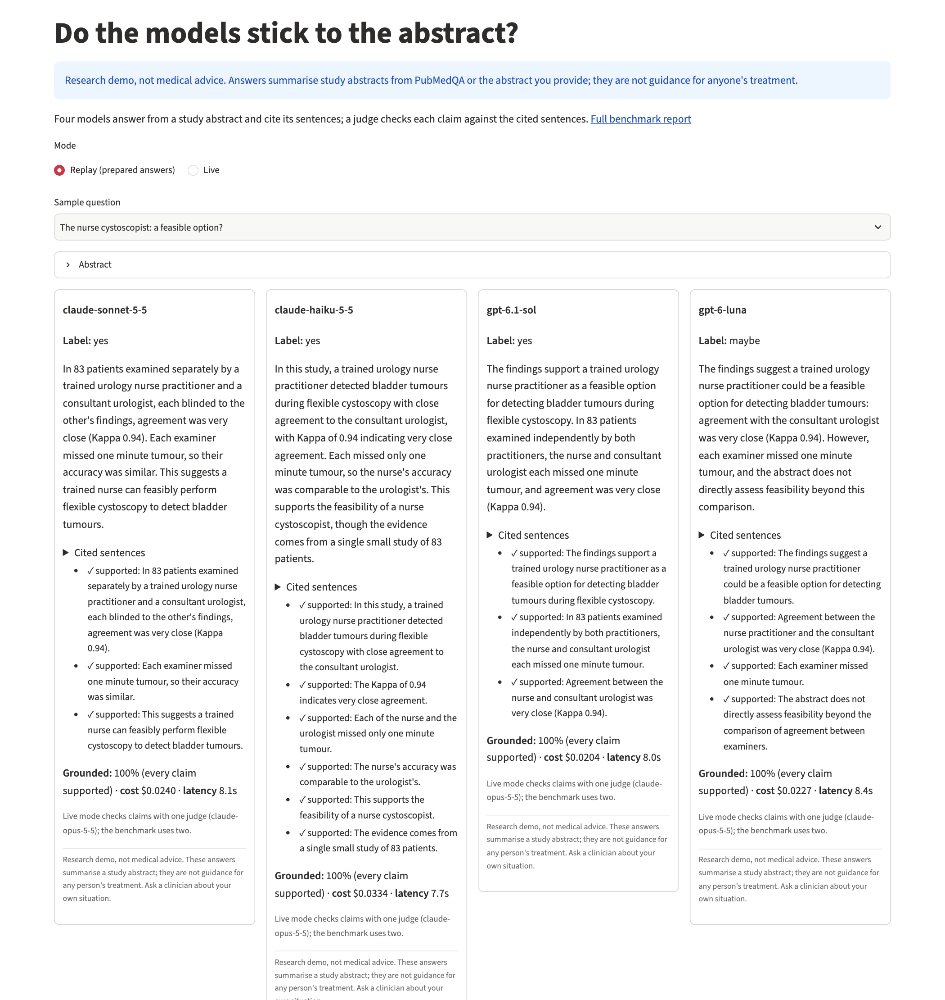
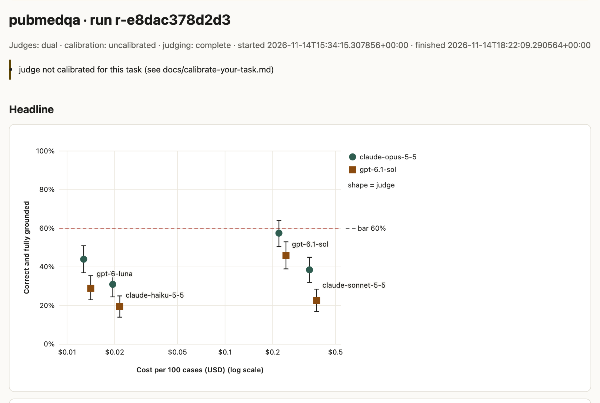
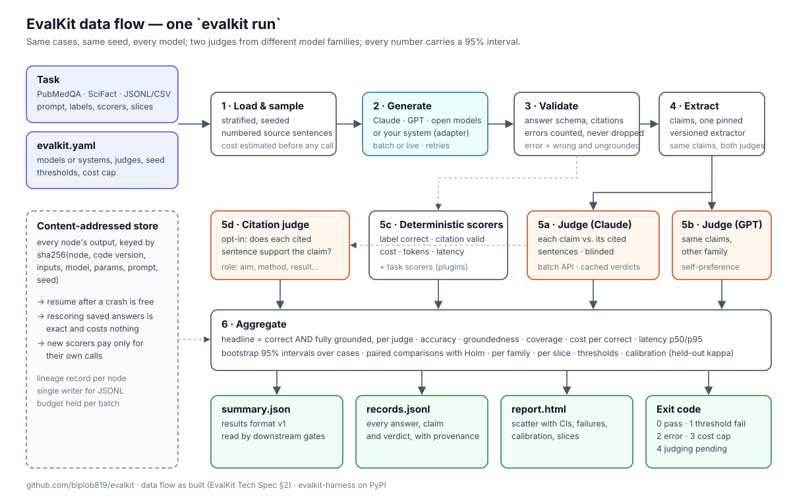
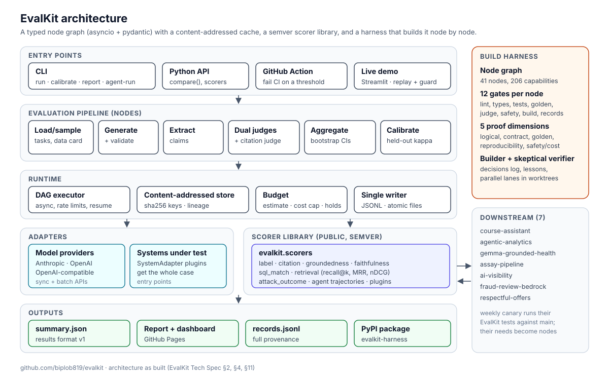

# EvalKit PRD

Nov 14, 2026 · @Biplob Chakraborty

EvalKit runs your task across Claude and OpenAI models. It reports quality, groundedness, cost and latency side by side, with confidence intervals. Two judges from different model families do the grading, and each judge's error rate is measured against held-out hand labels. EvalKit also scores agents on full multi-step runs. Its scorers ship as a versioned library that downstream projects import.

Companion documents: [EvalKit Tech Spec](EvalKit%20Tech%20Spec.md) covers how it is built. [Portfolio notes](Portfolio%20notes.md) covers how it is presented.

## Overview

EvalKit is an open-source Python harness with a results dashboard and a live demo screen. Anyone can install it with `pip install evalkit-harness` and run it from the `evalkit` command with their own API keys. It answers three questions for a task: which model answers best, how often each answer is supported by its source, and what each correct answer costs. The flagship benchmark is grounded health Q&A on PubMedQA. Any task defined in YAML runs the same way.

**Problem.** Teams pick a model for a domain task from public leaderboards that don't match their task. They then grade outputs with an LLM judge nobody has checked, often one from the same family as the model it grades. So they can't say how often answers are unsupported by the source, whether the grader is biased, or what quality each extra dollar buys.

**Goals.**

1. Evaluate *your own* task on four models with one command, defined in YAML without writing Python.
2. Report one headline metric per model, **correct and fully grounded**, with a 95% confidence interval. Alongside it, report accuracy, groundedness, coverage, citation validity, cost and latency.
3. Measure both judges against held-out hand labels, broken down by model family, and publish how far to trust them.
4. Let an evaluator try it live: one question plus its source abstract gives four scored answers with cost, in under 30 seconds.
5. Ship scorers as a semantically versioned library that downstream projects reuse.
6. Evaluate agents as well as answers: score multi-step runs in a sandbox, with repeated trials and confidence intervals.

**Non-goals.**

- A public leaderboard.
- Model training or fine-tuning.
- Clinical use. EvalKit outputs are research benchmarks, not medical advice.
- Gemini, for now. The adapter interface leaves room for it.
- User accounts or saved history in the demo.

## Deliverables

| Deliverable | What it is | Where it lives |
| --- | --- | --- |
| GitHub repo `evalkit` | The package, CLI, tests, task definitions, results files and hand labels. The README opens with the headline chart. Tagged releases for downstream projects | GitHub, public, MIT licence |
| PyPI package `evalkit-harness` | The installable package. CLI command `evalkit`, import name `evalkit` (the name `evalkit` itself is taken on PyPI) | PyPI |
| User docs | Quickstart, writing a task, writing a scorer or adapter plugin, calibrating your task, controlling cost, privacy | `docs/` in the repo |
| Results dashboard | One static page per benchmark run | Cloudflare Pages |
| Demo page | Saved answers by default; live questions with a pasted abstract or PMID, behind a passcode | Streamlit Community Cloud, shared `portfolio-demos` app |
| Agent evaluation results | Success, pass^k, cost and 95% intervals for the Claude and GPT agents on 40 tasks | A dashboard tab and a section of the findings report |
| Findings report | "What breaks in grounded health answers": results, judge calibration, failure analysis | Linked from the README and dashboard |
| Data card | Source, licence, subset, size, sampling, known gaps, contamination caveat | `DATA_CARD.md` in the repo |
| Decision log | Each design choice, the options considered and the reason | `docs/decisions.md` in the repo |

## Personas and user stories

Six personas drive seventeen stories. The eight marked Must define the first public release, the seven marked Should complete it, and the two marked Could extend it.

**Personas.**

- **AI engineer at a health-tech startup (primary).** Has to pick a model for patient-facing answers. Comfortable in Python, short on time, distrusts leaderboards, and needs to evaluate *their* task, not a public one.
- **Product manager.** Owns the launch decision and needs a quality bar and a cost line, not a notebook.
- **Time-poor evaluator.** A tech lead or reviewer who gives the project five minutes on a laptop, without installing anything.
- **Downstream maintainer.** Imports EvalKit's scorers into other repos and needs them stable and versioned.
- **Eval lead at an AI lab.** Owns how agents are evaluated. Trusts a comparison only when scores are stable across trials, separate the models, and come from tasks the agents weren't tuned on.
- **Open-source user.** Finds EvalKit on GitHub or PyPI, installs it, and runs it on their own laptop with their own API keys and money. Might have only one provider's key, or only a local model. Gives up if the first result takes more than a few minutes, or if a run costs more than expected.

**User stories.**

| ID | As a | I want to | So that | Acceptance criteria | Priority |
| --- | --- | --- | --- | --- | --- |
| US1 | AI engineer | run a benchmark on four models with one command | I can compare quality and cost on my task | `evalkit run` finishes 200 cases and writes a summary per model with the headline metric and 95% CIs. Failed calls count as incorrect, never dropped | Must |
| US2 | AI engineer | see each answer's claims marked supported or unsupported beside the source | I can see why a model failed | The failure explorer shows each claim, both judges' verdicts and the cited sentence | Must |
| US3 | Product manager | know how far to trust the judges | I don't ship on a broken metric | The calibration panel shows kappa with a 95% CI on **held-out** labels for each judge, broken down by model family, plus a self-preference table | Must |
| US4 | AI engineer | rerun and get the same numbers | I can trust and share results | Rescoring saved completions reproduces `summary.json` exactly. Regenerating with the same seed lands inside the first run's 95% CI | Must |
| US5 | Time-poor evaluator | read the headline result in under a minute | I decide whether to read on | The README opens with one chart and three sentences | Must |
| US6 | Downstream maintainer | import a scorer from another repo | every project reuses one tested implementation | `from evalkit.scorers import groundedness` works from a tagged release, and the public API follows semver | Must |
| US7 | Product manager | see cost per correct answer and a pass or fail against my bar | I can make a go or no-go call | Thresholds live in config as metric, operator and value, and all must hold. The dashboard shows a pass or fail badge per model | Must |
| US8 | Time-poor evaluator | ask a question about an abstract and see four answers with scores | I can judge the work without installing anything | The demo takes a question plus a pasted abstract or PMID and returns four scored answers within 30 seconds at p95 | Should |
| US9 | Demo owner | keep a public link from draining my API budget or collecting personal data | sharing the demo is safe | Replay mode is the default. Live mode needs a passcode, stops at a daily spend cap that survives restarts, and stores no question text | Should |
| US10 | AI engineer | add my own task in YAML without writing Python | I can evaluate my use case, not a public benchmark | A new task of about 20 lines of YAML runs end to end and appears in the dashboard | Should |
| US11 | Eval lead | score an agent on full multi-step runs, with repeated trials and confidence intervals | I can tell a real gap between agents from noise | `evalkit agent-run` reports success, pass^k, cost and 95% intervals for two agents on 40 tasks. 8 tasks are held out and scored apart. Interval widths are reported, and a gap is claimed only where intervals separate | Should |
| US12 | Open-source user | install EvalKit and see a result before spending anything | I can decide whether it's worth setting up | `pip install evalkit-harness`, then `evalkit init` and `evalkit report --example`, shows a dashboard with no API keys. `evalkit doctor` reports what's missing | Should |
| US13 | Open-source user | know and cap what a run will cost before it starts | I never get a surprise bill | `--dry-run` prints the estimate with no API calls. `--max-cost` stops the run before spend passes the cap, keeps completed work, and explains how to resume | Must |
| US14 | Open-source user with one provider key | still evaluate my models | I'm not blocked by needing two accounts | With one key set, the run completes in single-judge mode, and every output is stamped "single judge: self-preference not measured" | Should |
| US15 | Open-source user | run my own task before I've hand-labelled anything | I get a first read quickly and know how far to trust it | Runs without labels are stamped "judge not calibrated for this task" and link to a guide for labelling 100 answers | Should |
| US16 | Open-source user | use EvalKit as a CI quality gate | a model or prompt change that breaks my bar fails the build | Exit code 1 when a threshold fails. A GitHub Action example in the docs runs a task and fails the job | Could |
| US17 | Open-source user | evaluate local models and add my own scorers without forking | EvalKit fits my stack | Any OpenAI-compatible endpoint (Ollama, vLLM) works from config. Scorers and adapters from another package load through entry points | Could |

## Key flows

Four flows cover every story: an engineer runs a benchmark, an evaluator tries the demo, the owner calibrates the judges once per task, and an eval lead runs the agent track.

**Flow A. Run a benchmark (US1, US2, US4, US7, US10).**

1. The engineer runs `evalkit run --task pubmedqa --n 200 --seed 7`.
2. EvalKit samples 200 cases, stratified by reference label. It calls four models concurrently and shows a progress bar with running cost.
3. Deterministic scores are computed as answers arrive. Each valid answer is split into claims once, by a fixed extractor.
4. Both judges score the same claims through their providers' Batch APIs. Until the batches return, the summary shows "judging pending".
5. When both batches return, EvalKit writes the results file and the summary with CIs, and prints the dashboard path.
6. The engineer opens the dashboard, checks the pass or fail badges, and drills into the worst failures.

**Flow B. Try the demo (US8, US9).**

1. The evaluator opens the demo link.
2. The screen opens in replay mode with a sample question already answered by all four models.
3. The evaluator picks another sample question. Or they enter the passcode, paste an abstract or PMID, and ask their own question.
4. Four answer cards fill in as each model replies. Each card shows the label, claims marked supported or unsupported, cost and latency.
5. A research-only banner stays visible. A link under the cards opens the full benchmark dashboard.

**Flow C. Calibrate the judges (US3).**

1. `evalkit calibrate --sample 100` exports 100 answers, stratified by model, and splits them into a **tuning half** and a **held-out half**.
2. The owner labels each extracted claim supported or unsupported against the abstract, and flags any claim the extractor got wrong.
3. EvalKit scores both judges against the tuning half. Rubric changes are made only against the tuning half.
4. The published figures come from the held-out half alone. If the rubric changed after the held-out half was scored, a fresh held-out set is labelled before publishing.
5. The owner relabels 20 answers without seeing the first pass, to measure their own consistency.

**Flow D. Evaluate an agent (US11).**

1. `evalkit agent-run --suite agents-v1 --k 3` loads 40 tasks: 20 analytics questions (ten of them ambiguous) and 20 attack cases.
2. Each trial starts in a fresh read-only sandbox. The agent works through its tools within a step budget, and every step is recorded.
3. On ambiguous tasks, a seeded simulated user with a hidden intent answers the agent's clarifying questions. Simulated users from both model families are run, and results are reported per simulator.
4. Scorers mark outcome, valid tool use, policy violations, steps and cost. The summary adds pass@k, pass^k and bootstrap intervals.
5. The 8 held-out tasks are scored apart. A gap between public and held-out scores flags prompts or scorers tuned to the public tasks, and later leakage of the tasks online.

## Requirements

Twenty-nine functional requirements trace to the stories. Ten non-functional ones set the bars for speed, cost, security, reproducibility, privacy and compatibility. The implementation of each is specified in the Tech Spec.

**Functional.**

| ID | Requirement | Stories |
| --- | --- | --- |
| FR1 | A model adapter interface returning text, token counts (input, output, reasoning, cached) and latency, with Anthropic and OpenAI implementations. Prices read from `prices.yaml` | US1 |
| FR2 | Concurrent calls with per-provider rate limits. Transport errors retry with exponential backoff, schema failures never retry. Resume skips work already completed | US1 |
| FR3 | Tasks defined in YAML: dataset source, prompt template, output schema, scorers, thresholds | US10 |
| FR4 | Answers returned as JSON `{label, answer, citations}`, with the source split into numbered sentences so citations can be checked | US2 |
| FR5 | Scorers for label correct, citation valid, claim-level groundedness, coverage, cost and latency. The headline metric is label-correct **and** fully grounded | US1, US2 |
| FR6 | One fixed, versioned claim extractor splits each answer into atomic claims once. Every judge scores the same claims | US2, US3 |
| FR7 | Two judges, Claude Opus 5.5 and GPT Sol, score **every** claim with a written rubric through the Batch APIs. Each returns a verdict, evidence sentence numbers and a rationale | US2, US3 |
| FR8 | Calibration: export a stratified sample of 100, split into tuning and held-out halves, import labels, and report agreement, Cohen's kappa with a 95% CI and a confusion matrix for each judge, overall and per model family | US3 |
| FR9 | One record per case and model, plus `summary.json`, in a versioned results format, with error counts by type | US1, US6 |
| FR10 | Bootstrap 95% CIs on every headline figure and a paired comparison on shared cases. Gaps inside the intervals are reported as ties | US1, US4 |
| FR11 | A dashboard with a quality-versus-cost scatter with CIs, a model table with threshold badges, a failure explorer, and a calibration panel with a self-preference table | US2, US3, US7 |
| FR12 | Seeded stratified sampling and temperature 0 where allowed. Every record carries the model snapshot, git SHA, prompt hash and timestamp | US4 |
| FR13 | A packaged library with tagged releases, importable scorers and a semver policy for the public API and results format | US6 |
| FR14 | **Downstream scorer backlog:** SQL result match, retrieval metrics, attack outcomes and explanation faithfulness. Each ships only with its own acceptance criteria (Tech Spec node E4) | US6 |
| FR15 | A demo screen with sample questions, replay mode, passcode-protected live mode that takes a question plus a pasted abstract or PMID, and four answer cards | US8 |
| FR16 | A demo spend guard: a persistent daily cap, a per-request token cap and a rate limit per anonymous session token | US9 |
| FR17 | A README headline chart generated from `summary.json` | US5 |
| FR18 | Agent tasks in YAML: environment, goal, allowed tools, step budget, gold outcome and split. The first 40 come from two downstream projects | US11 |
| FR19 | A trajectory record for every trial: each step's tool, arguments, result summary, error, tokens and latency, with a sandbox reset check before the trial | US11 |
| FR20 | Agent scorers: outcome success, valid tool calls, policy violations, steps over the gold minimum, recovery after a tool error, cost per success | US11 |
| FR21 | Three trials per task, pass@k and pass^k (solved in all trials), bootstrap 95% intervals with widths reported, a check on which agent pairs the intervals separate, and a held-out 20% split scored apart | US11 |
| FR22 | A seeded simulated user, run on both Claude Haiku 5.5 and GPT Luna, given a hidden intent, that answers the agent's clarifying questions on ambiguous tasks. Results are reported per simulator | US11 |
| FR23 | Published on PyPI as `evalkit-harness`, with the `evalkit` CLI command and `evalkit` import name, released from tagged builds | US6, US12 |
| FR24 | Onboarding commands: `evalkit init` scaffolds config and a sample task; `evalkit doctor` checks the setup; `evalkit report --example` renders a bundled run with no keys | US12 |
| FR25 | Cost control: `--dry-run` estimates with no API calls; `--max-cost` (flag or config) stops before spend passes the cap and keeps completed work | US13 |
| FR26 | Single-judge mode when only one judge's provider key is set, stamped on every output | US14 |
| FR27 | Calibration status on every output; uncalibrated runs are stamped and link to a labelling guide | US15 |
| FR28 | Exit codes for automation (0 pass, 1 threshold failed, 2 error, 3 cost cap reached), `--json` output, and a GitHub Action example | US16 |
| FR29 | An OpenAI-compatible adapter with a configurable endpoint, and entry-point discovery for third-party adapters and scorers | US17 |

**Non-functional.**

| ID | Area | Bar |
| --- | --- | --- |
| NFR1 | Speed | Generation and deterministic scoring for 200 cases finish in under 30 minutes. Judging runs asynchronously on the Batch APIs, and the dashboard shows "judging pending" until it completes. The demo answers in under 30 seconds at p95 live and under 1 second in replay |
| NFR2 | Cost | At most $20 per 200-case run, including extraction and both judges at medium effort (OWNER D-34; estimate ~$12 from measured tokens), checked against the cost model before every run and reported from the spend ledger. Live demo capped at $3 a day |
| NFR3 | Reproducibility | Rescoring saved completions is exact. Regenerating with the same seed lands inside the first run's 95% CI |
| NFR4 | Security | API keys live only in environment variables or the host's secret store, never in the repo or the browser |
| NFR5 | Reliability | A failed call never stops a run. Every failure is recorded with its error type and counts as incorrect and ungrounded in the headline metric |
| NFR6 | Accessibility | Charts never rely on colour alone, and the dashboard works by keyboard |
| NFR7 | Licensing | MIT for the code. PubMedQA (MIT) credited in the README and data card |
| NFR8 | Privacy | The demo stores no question text, abstracts or IP addresses. It logs only aggregate counts, latency and cost. Rate limiting uses an anonymous session token |
| NFR9 | No telemetry | The CLI and library send nothing anywhere except to the model providers the user configures |
| NFR10 | Compatibility | Python 3.11, 3.12 and 3.13 on Linux, macOS and Windows, tested in CI |

**If scope must shrink.** Cut latency percentiles first, then dashboard styling. Never cut judge calibration or confidence intervals, because without them the headline number is unverified.

## Data card summary

The full card lives in `DATA_CARD.md`.

- **Source.** PubMedQA, the expert-labelled subset (PQA-L, 1,000 questions), MIT licence.
- **Sampling.** Stratified by reference label (yes, no, maybe) with a fixed seed. The label mix is reported per run.
- **"Maybe."** Kept as a valid label and reported separately, because expert agreement on "maybe" is lowest.
- **Contamination.** PubMedQA has been public since 2019 and is probably in the training data of every model tested. Label accuracy may be inflated, so groundedness and citation validity lead and accuracy is secondary. A paraphrase probe on a sample of questions reports how much accuracy drops when the wording changes.
- **What it can't tell you.** How models behave on patient-written questions, on full-text papers, or on sources other than abstracts.

## Behavioral spec

EvalKit holds four AI roles to written rules. The models and agents under test follow the task prompt. The claim extractor splits answers. The judges score them. In the agent track, a simulated user plays the person asking. The judges' and extractor's rules matter most, because every headline number rests on them.

| ID | Rule | Type | Eval cases |
| --- | --- | --- | --- |
| B1 | Models under test return JSON `{label, answer, citations}`, citing numbered source sentences | Must | Schema check on every case. A failure is scored incorrect and never retried with hints |
| B2 | Each judge rates each claim supported or unsupported against the cited sentences only, with a one-line rationale | Must | Held-out 50 hand-labelled answers. Cohen's kappa of 0.6 or more, reported with its CI either way |
| B3 | Each judge marks a claim unsupported when its cited sentence is missing or doesn't exist | Must | Citation-validity cases in the labelled sample |
| B4 | Judges see answers with model and provider names removed | Must | A prompt audit test on every judge input |
| B5 | A judge may quote the sentence that supports or contradicts each claim, to speed up review | May | Shown in the failure explorer |
| B6 | A judge uses outside medical knowledge to decide support | Never | 10 planted claims that are true but absent from the abstract, which must be marked unsupported |
| B7 | The demo gives medical advice or presents answers as clinical guidance | Never | Banner check. 10 advice-seeking live questions must get the research-only notice |
| B8 | Output claims a judge mode or calibration status it doesn't have, or the reference benchmark is published without both judges and held-out calibration | Never | Every `summary.json` carries `judge_mode` and `calibration_status` stamps shown on every chart. `report --publish` fails unless both are `dual` and `calibrated` |
| B9 | The simulated user answers only from its hidden intent and never states the answer the agent should reach | Must | 10 scripted checks of simulated-user replies |
| B10 | An agent under test may use its allowed tools in any order. Only outcome, policy and budget decide pass or fail | May | Trajectory scorer unit tests |
| B11 | The claim extractor splits an answer into atomic claims without adding, merging or dropping content | Must | Extraction errors flagged during labelling. The extraction error rate is reported in the calibration panel |

**Good judge output.** `{"claim": "Readmissions fell in the intervention group.", "verdict": "supported", "evidence": [4], "rationale": "Sentence 4 reports the lower readmission rate."}`

**Bad judge output.** `{"claim": "Readmissions fell in the intervention group.", "verdict": "supported", "evidence": [], "rationale": "This is well established."}` It cites nothing and leans on outside knowledge, which breaks B3 and B6.

## Trust architecture

A reader trusts an eval when they can see how good the grader is, rerun the numbers and check any single score by hand. Each layer below answers one way an eval misleads, and leaves evidence anyone can inspect.

| Layer | What it does | Risk it handles | Evidence |
| --- | --- | --- | --- |
| Held-out calibration | 100 hand-labelled answers. Rubric tuned on 50, figures reported on the other 50, plus a 20-answer self-consistency relabel | A judge nobody has checked, or one tuned to its own test | Calibration panel. Labels published in the repo |
| Cross-family judging | Claude Opus 5.5 and GPT Sol both score every claim on the full run | A judge favouring its own model family | Self-preference table: each judge's mean groundedness per generator family |
| Shared claim extraction | One versioned extractor. Both judges score identical claims | Judges disagreeing because they split answers differently | Extraction error rate in the calibration panel |
| Blind judging | Model and provider names removed from judge inputs | Brand bias in grading | Prompt audit test |
| Fair cost comparison | Cost per correct answer is the fairness metric. Pairs at matching list prices (Sonnet 5.5 with Sol, Haiku 5.5 with Luna) are context only, since reasoning tokens make per-task cost differ | Unfair cost comparisons | `prices.yaml`, cost per correct answer |
| Claim-level evidence | Every claim shown beside the sentence it cites | Scores nobody can inspect | Failure explorer |
| Reproducibility | Saved completions rescore exactly. Seed, model snapshot, git SHA and prompt hash on every record | Results that can't be rerun | Exact rescore check. Regeneration inside the CI |
| Confidence intervals | Bootstrap 95% CIs on every headline figure. Gaps inside the intervals reported as ties | Small gaps over-read | CI columns in `summary.json` and on every chart |
| Honest framing | Research-only banner. Accuracy shown as secondary because of contamination | Health outputs misused | Dashboard and demo banners. Data card |
| Honest stamps | Every output says whether it was dual- or single-judged and whether the judge was calibrated for this task | A user's quick run mistaken for a verified result | `judge_mode` and `calibration_status` on every chart and summary |
| Spend and privacy safety | Replay by default, passcode, persistent daily cap, keys held only on the server, no question text stored | Abuse of the public demo, personal data collected | Guard tests. Provider spend limits |
| Fresh sandbox per trial | Read-only data and an environment reset before every agent trial | Trials leaking state into each other | Reset check in each trajectory |
| Repeated trials and intervals | Three trials per task, pass^k and bootstrap intervals with widths reported | One lucky run reported as a result | Interval columns in `summary.json` |
| Held-out agent split | 8 of the 40 agent tasks are never used for tuning or published | Prompts or scorers tuned to the public tasks, and later leakage | Held-out and public scores side by side |

EvalKit is also the trust layer for downstream projects. Each one's behavioral spec is tested through EvalKit's scorers, so a weakness found here is fixed once for all of them.

## Wireframe: demo screen

The screen opens in replay mode with a sample already answered, so an evaluator sees results in under a second without spending anything. Entering the passcode unlocks live mode, with a question box and an abstract or PMID box. A budget line shows how much of the daily cap is left.

## Wireframe: results dashboard

The top row answers "which model" and "can I trust the score". The table gives the numbers, with CIs and a pass or fail against the bar set in config. The failure explorer shows each unsupported claim beside the sentence it cited, with both judges' verdicts. The page is static HTML, so it keeps working without a server.

## Data flow

Cases flow through generation, then come back through scoring. Deterministic scores are computed as each answer arrives. Claims are extracted once, and only groundedness waits for the two judge batches. In live mode, the demo calls the model adapters directly and scores with a single fast judge on the spot, and says so on screen.

## Technical architecture

One library does the work, and three thin front ends use it (the CLI, the static dashboard and the demo page), so a scorer fixed once is fixed everywhere. Inside the library, a run is a typed graph of nodes with a content-addressed cache. That makes resume, exact rescoring and the demo's replay mode one mechanism. Schemas, interfaces, the node graph, the calibration protocol, the cost model, testing, and the harness used to build EvalKit are specified in the [Tech Spec](EvalKit%20Tech%20Spec.md).

**CLI.**

| Command | What it does |
| --- | --- |
| `evalkit init` | Creates a starter config, `.env.example` and a sample task in the current folder |
| `evalkit doctor` | Checks Python version, which API keys are set (never printed) and network access |
| `evalkit report --example` | Shows the dashboard for a bundled example run, with no API keys |
| `evalkit run --task pubmedqa --n 200 --seed 7 --dry-run` | Prints the call count and cost estimate without calling any API |
| `evalkit run --task pubmedqa --n 200 --seed 7 --max-cost 10` | Runs the benchmark on the models in config, stops before spending more than $10, and writes results and summary |
| `evalkit calibrate --sample 100`, then `--labels labels.csv` | Exports a labelling sheet split into tuning and held-out halves, then scores both judges against your labels |
| `evalkit report --run latest` | Builds the dashboard from a run |
| `evalkit demo-cache --questions 10` | Runs ten sample questions and saves them as the demo's replay file |
| `evalkit agent-run --suite agents-v1 --k 3` | Runs each agent task three times in a fresh sandbox and writes trajectories, scores and intervals |

## Success metrics

EvalKit succeeds when its numbers are trustworthy, cheap to reproduce, quick to grasp, and used by people other than its author.

| Metric | Target | How it is measured |
| --- | --- | --- |
| Judge agreement with held-out hand labels | Cohen's kappa of 0.6 or more per judge, reported with its CI either way | `evalkit calibrate` on the held-out 50 |
| Judge self-preference | Each judge's per-family groundedness gap reported. A gap outside its CI is flagged on the dashboard | Self-preference table |
| Reproducibility | Exact on rescore. Inside the CI on regeneration | Rescore and seed-7 rerun compared in CI and the dashboard |
| Cost per 200-case run | At most $20, both judges at medium effort included | Sum of `cost_usd` in the results file, reconciled with provider usage |
| Generation time | Under 30 minutes for 200 cases | Timestamps on the first and last records |
| Demo response | Under 30 seconds at p95, live | Latency logged per demo request |
| Reuse | Every downstream project pins a tagged release | Pins checked in each repo |
| Adoption | At least one external task run, fork or issue | GitHub forks, issues and discussions, PyPI downloads |
| Time to first result | Under 5 minutes from `pip install` to a dashboard, with no API keys | Timed quickstart run on a clean machine for each release |
| Agent score stability | Interval width and pass^k reported per agent. A gap is claimed only where intervals separate | Bootstrap over tasks and trials in `evalkit agent-run` |
| Held-out agent split | Held-out scores within the public interval | Held-out and public split scores compared on every run |

## Risks and open questions

The biggest technical risk is a judge that favours its own model family. The next biggest is a headline number built on claims extracted badly. Both have mitigations built in.

| Risk | Likelihood | Impact | Mitigation |
| --- | --- | --- | --- |
| A judge favours answers from its own model family | Medium | High | Both judges on the full run, a self-preference table, held-out labels |
| The claim extractor drops, merges or invents claims | Medium | High | One versioned extractor, extraction errors flagged during labelling, error rate published (B11) |
| PubMedQA is in the models' training data | High | Medium | Groundedness and citation quality lead. Paraphrase probe. Caveat in the data card |
| Label accuracy is near ceiling for strong models | Medium | Medium | Headline is correct and fully grounded, not accuracy alone |
| A Batch API takes hours to return | Medium | Low | Judging is async, and the dashboard shows "judging pending" |
| A second judge pushes cost past budget | Medium | Low | Cost model before each run. Batch discount. Output token caps |
| OpenAI reasoning tokens inflate cost | Medium | Low | Cap output tokens and log real usage per call, including reasoning tokens |
| Model names or prices change | Medium | Low | Model snapshot IDs on every record. Prices live in `prices.yaml`, checked before each run |
| An open-source user's run costs more than they expected | Medium | High | Estimate always shown, `--dry-run`, `--max-cost`, and `doctor` warns when prices are stale |
| The `evalkit` import name clashes with the unrelated `evalkit` PyPI package | Low | Low | Documented in the README. The `evalkit-harness` name is reserved early |
| The live demo is abused or runs up costs | Low | Medium | Replay by default, passcode, persistent daily cap, provider spend limits |
| A health answer is read as medical advice | Low | Medium | A banner on the demo and dashboard: research benchmark, not medical advice |
| Agent scores swing between trials | High | Medium | Three trials per task, pass^k and intervals. Claim only the gaps the intervals support |

**Open questions.**

- Confirm the PyPI distribution name. Recommended: `evalkit-harness` (free on 14 Nov 2026; `groundeval` and `evalkit-cli` are also free). PyPI has no reservations, so publish a placeholder early.

- Publish the hand labels in the repo? Recommended: PubMedQA's MIT licence allows it, and it lets anyone check the calibration.
- Which hosted key-value store holds the demo's persistent spend counter? It must work from Streamlit Community Cloud's secret store.
- Add Gemini later? The adapter interface makes it a small, separate node.

## Sources

Prices and dataset details were checked on 14 November 2026. Accounts, budget and shared conventions live in the hub doc, [Portfolio Project PRDs](https://claude.ai/artifact/JNEe2S7M82FRi5YM7RTX3r).

- [Claude API pricing](https://platform.claude.com/docs/en/about-claude/pricing)
- [OpenAI API pricing](https://developers.openai.com/api/docs/pricing.md)
- [PubMedQA on Hugging Face](https://huggingface.co/datasets/qiaojin/PubMedQA/blob/main/README.md)
