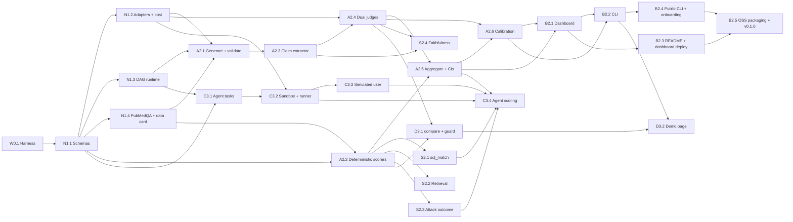

# EvalKit Tech Spec

Nov 14, 2026 · @Biplob Chakraborty · Companion to the [EvalKit PRD](EvalKit%20PRD.md)

The PRD says what EvalKit does and why. This spec says how it is built: the runtime node graph, schemas, interfaces, judging and calibration, statistics, the demo, the agent sandbox, the cost model, testing, and the build harness used to deliver it node by node.

---

## 1. Design decisions

Each decision below seeds `docs/decisions.md` as D-1 to D-12.

| ID | Decision | Alternatives considered | Why |
| --- | --- | --- | --- |
| D-1 | A run is a typed DAG of nodes, executed by a small in-house runtime (asyncio + pydantic) | Inspect AI as the engine; LangGraph; Hamilton, Prefect or Dagster | Downstream repos import EvalKit, so it must stay dependency-light and stable. Claim extraction, dual judging and bootstrap aggregation are custom anyway. The cache, resume and replay design stays fully explainable |
| D-2 | Content-addressed node cache, keyed on node, code version, inputs, model, params, prompt hash and seed | Plain JSONL checkpoints | One mechanism gives resume, exact rescoring, cheap reruns and the demo replay file |
| D-3 | A single fixed, versioned claim extractor feeds both judges | Each judge extracts its own claims | Judge agreement is only meaningful on identical claim sets |
| D-4 | Opus 5.5 and GPT Sol both judge every claim on the full run | Sol only on the labelled set; Sol on a 25% sample | Self-preference only shows when results are split by generator family, so it has to be measured everywhere it can occur |
| D-5 | Calibrate on 100 labels: 50 for tuning, 50 held out, plus a 20-answer self-consistency relabel | 50 labels, tuned and reported on the same set | A reported kappa must not be training accuracy |
| D-6 | The live demo takes a question plus a pasted abstract or PMID | Retrieve from PubMed; dataset questions only; ungrounded live mode | Keeps groundedness meaningful with no retrieval step that can fail |
| D-7 | Demo hosted in the shared Streamlit Community Cloud app `portfolio-demos`, with a persistent spend counter in a hosted KV store | Hugging Face Spaces; in-memory counter | One deployment, passcode and secret store. In-memory counters reset whenever the app sleeps |
| D-8 | Built with a lean adaptation of the Kova node harness: a single builder plus a skeptical verifier | Full Kova (lanes, integrator, EM agent); tests only | Gives dependency-gated, verifiable progress without months of process overhead |
| D-9 | Published on PyPI as `evalkit-harness`, with CLI command `evalkit` and import name `evalkit` | GitHub-only install; renaming the project | `evalkit` on PyPI belongs to an unrelated package (checked 14 Nov 2026). A new distribution name keeps the brand and a normal `pip install` |
| D-10 | Dual judging by default; labelled single-judge mode when only one provider key is set | Require both keys; any judge models | Users with one key can still evaluate. Every output says plainly that self-preference wasn't measured. The maintainer's published benchmark still requires both judges |
| D-11 | No telemetry of any kind | Opt-in usage analytics | Users send their own data to their own providers. The tool shouldn't send anything anywhere else |
| D-12 | Adapters and scorers are discoverable through Python entry points; an OpenAI-compatible adapter takes any `base_url` | Fork-and-edit extension | Users add providers (including free local models through Ollama or vLLM) and scorers from their own packages without touching EvalKit |

---

## 2. Runtime node graph

### 2.1 Node contract

```python
class Node(Generic[In, Out]):
    name: ClassVar[str]  # "generate"
    code_version: ClassVar[str]  # bump when the logic changes; invalidates cache
    In: type[BaseModel]
    Out: type[BaseModel]

    def cache_key(self, inp: In, ctx: RunContext) -> str:
        # sha256 over canonical JSON of:
        # name, code_version, inp, ctx.model, ctx.params, ctx.prompt_hash, ctx.seed
        ...

    async def run(self, inp: In, ctx: RunContext) -> Out: ...
```

- **Store.** Outputs are written atomically (write to a temp file, then rename) to `.evalkit/store/<key[:2]>/<key>.json`.
- **Lineage.** Each output has a sidecar recording `{key, node, parents: [keys], started_at, finished_at, cost_usd}`.
- **Cache hit.** A key already present in the store skips the node. Resume is simply rerunning the graph.
- **Idempotency.** The unit of work is (run_id, node, case_id, model). Batch nodes persist the batch id under their key, so a resumed run collects the existing batch instead of submitting a new one.
- **Writer.** One writer task drains a queue and appends records to `results/<run_id>/records.jsonl`. Worker tasks never write the file directly.

This combines Hamilton and Dagster's data-version pattern with Inspect's cache-key fields (see Sources).

### 2.2 Benchmark graph

```
LoadDataset ─▶ Sample(seed, stratified) ─▶ Generate[model × case] ─▶ Validate
                                                                       │
                       ┌───────────────────────────────────────────────┤
                       ▼                                               ▼
               DeterministicScore                               ExtractClaims
       (label, citation validity, cost, latency)                       │
                       │                                  ┌────────────┴────────────┐
                       │                                  ▼                         ▼
                       │                         JudgeOpus (batch)          JudgeSol (batch)
                       │                                  │                         │
                       └──────────────────────┬───────────┴─────────────────────────┘
                                              ▼
              Aggregate (bootstrap CIs, per judge, per family, errors, thresholds)
                                              │
                                ┌─────────────┼──────────────┐
                                ▼             ▼              ▼
                             Report       Calibrate      DemoCache
```

- **Generate** fans out across models × cases under per-provider semaphores and token-bucket rate limits.
- **Validate** parses the `Answer` JSON. A failure yields `answer=None` and `error="schema"`.
- **ExtractClaims** uses one pinned model and prompt (`extractor_version`) and emits a `Claim` list per valid answer.
- **Judge nodes** run in three steps:
  1. `submit`: build one request per claim set with `custom_id = f"{run_id}:{case_id}:{model}"`, then submit.
  2. `poll`: back off up to the provider's SLA.
  3. `collect`: map results back by `custom_id`, and validate them against `ClaimVerdict`.

### 2.3 Agent graph

```
LoadAgentTasks ─▶ for task × agent × trial(k):
                     SandboxReset ─▶ Trial ⇄ SimUser(family, seed) ─▶ TrajectoryScore
                 ─▶ AgentAggregate (pass@k, pass^k, bootstrap, separation check, held-out split)
```

### 2.4 Error and retry rules

| Error | Retry | Scored as |
| --- | --- | --- |
| Transport, 429, 5xx | Exponential backoff with jitter, up to 6 attempts | Incorrect and ungrounded if it still fails |
| Schema failure (invalid JSON or fields) | Never | Incorrect and ungrounded |
| Refusal | Never | Incorrect; counted separately as `refusal` |
| Judge parse failure | Once, with the same prompt | Claim excluded from that judge, and counted |

- `Completion.error` holds the error type, and `ModelSummary.n_errors` counts errors by type.
- Native structured-output mode is either on for every provider or off for every provider, recorded in `RunConfig.structured_output`.

---

## 3. Schemas (pydantic)

Results format v1. Every file carries `schema_version: "1.0"`.

```python
class Case(BaseModel):
    id: str  # "pqa-00042"
    question: str
    context: list[str]  # source split into numbered sentences
    reference_label: Literal["yes", "no", "maybe"]
    source: str  # "pubmedqa/pqa_l"


class Answer(BaseModel):
    label: Literal["yes", "no", "maybe"]
    answer: str
    citations: list[int]


class Completion(BaseModel):
    model: str  # alias from config
    model_snapshot: str  # exact provider model id
    params: dict[str, float | int | str]  # temperature, max_tokens, ...
    raw_text: str
    answer: Answer | None
    tokens_in: int
    tokens_out: int
    tokens_reasoning: int = 0
    tokens_cached: int = 0
    latency_ms: int
    cost_usd: float
    request_id: str | None
    error: Literal["transport", "schema", "refusal"] | None


class Claim(BaseModel):
    id: str  # f"{case_id}:{model}:{i}"
    text: str
    cited: list[int]
    extractor_version: str


class ClaimVerdict(BaseModel):
    claim_id: str
    judge: str  # "claude-opus-5-5" | "gpt-6.1-sol"
    verdict: Literal["supported", "unsupported"]
    evidence: list[int]
    quote: str | None = None  # B5
    rationale: str
    judge_prompt_hash: str


class Scores(BaseModel):
    label_correct: bool
    citation_valid: float  # share of citations that exist
    groundedness: dict[str, float]  # per judge: share of claims supported
    fully_grounded: dict[str, bool]  # per judge
    coverage: float  # claims addressing the question / expected key points
    correct_and_grounded: dict[str, bool]  # headline, per judge


class Record(BaseModel):
    schema_version: str
    run_id: str
    task: str
    case_id: str
    timestamp: datetime
    completion: Completion
    claims: list[Claim]
    verdicts: list[ClaimVerdict]
    scores: Scores
    seed: int
    git_sha: str
    prompt_hash: str


class Interval(BaseModel):
    point: float
    lo: float
    hi: float


class ModelSummary(BaseModel):
    model: str
    family: Literal["anthropic", "openai"]
    n: int
    n_errors: dict[str, int]
    headline: dict[str, Interval]  # correct_and_grounded, per judge
    accuracy: Interval
    groundedness_mean: dict[str, Interval]
    citation_validity: Interval
    coverage: Interval
    cost_per_100_usd: float
    cost_per_correct_usd: float
    latency_p50_ms: int
    latency_p95_ms: int
    passes_threshold: bool
    failed_thresholds: list[str]


class JudgeAgreement(BaseModel):
    judge: str
    kappa: Interval
    agreement: float
    confusion: list[list[int]]
    by_family: dict[str, Interval]  # kappa per generator family


class RunSummary(BaseModel):
    schema_version: str
    run_id: str
    task: str
    config_hash: str
    judge_mode: Literal["dual", "single"]
    calibration_status: Literal["calibrated", "uncalibrated"]
    models: list[ModelSummary]
    judges: list[JudgeAgreement]  # B8: both required to publish
    self_preference: dict[str, dict[str, Interval]]  # judge -> family -> mean groundedness
    extraction_error_rate: float
    judging_status: Literal["pending", "complete"]
    started_at: datetime
    finished_at: datetime | None


class CalibrationLabel(BaseModel):
    claim_id: str
    split: Literal["tuning", "heldout", "relabel"]
    label: Literal["supported", "unsupported"]
    extraction_error: bool = False


class Threshold(BaseModel):
    metric: str  # "headline", "cost_per_correct_usd", ...
    op: Literal[">=", "<="]
    value: float


class RunConfig(BaseModel):
    models: list[str]
    judges: list[str]
    extractor: str
    thresholds: list[Threshold]  # all must hold
    structured_output: bool
    max_output_tokens: int
    concurrency: dict[str, int]  # per provider
    seed: int
    max_cost_usd: float | None = None  # user's own hard cap; None = no cap, estimate still shown
    endpoints: dict[str, str] = {}  # model alias -> base_url for OpenAI-compatible servers


class TaskConfig(BaseModel):  # loaded from YAML
    name: str
    dataset: str
    split: str
    prompt_template: str
    output_schema: str
    scorers: list[str]
    thresholds: list[Threshold] = []
```

**Agent track (results format v1).**

```python
class AgentTask(BaseModel):
    id: str
    source_project: str  # free string; no downstream names in the library
    goal: str
    allowed_tools: list[str]
    step_budget: int
    gold_outcome: GoldOutcome  # discriminated union: ResultSet | AttackBlocked
    simulated_user_intent: str | None
    split: Literal["public", "heldout"]


class Step(BaseModel):
    index: int
    tool: str
    arguments: dict[str, Any]
    result_summary: str  # size or shape, tool-agnostic
    error: str | None
    tokens_in: int
    tokens_out: int
    latency_ms: int


class Trajectory(BaseModel):
    task_id: str
    agent: str
    simulator: str | None
    trial: int
    seed: int
    steps: list[Step]
    final_answer: str
    sandbox_reset_ok: bool
    cost_usd: float


class AgentScore(BaseModel):
    task_id: str
    agent: str
    trial: int
    success: bool
    valid_tool_calls: float
    policy_violations: int
    steps_over_gold: int
    recovered_from_error: bool | None
    cost_usd: float
    error: str | None
```

---

## 4. Interfaces and versioning

```python
class ModelAdapter(Protocol):
    provider: str

    async def complete(self, req: CompletionRequest) -> Completion: ...
    async def submit_batch(self, reqs: list[BatchRequest]) -> str: ...
    async def collect_batch(self, batch_id: str) -> list[BatchResult] | None: ...


class Scorer(Protocol):
    name: str
    version: str

    def __call__(self, case: Case, completion: Completion, **ctx) -> ScoreResult: ...


class ClaimExtractor(Protocol):
    version: str

    async def extract(self, answer: Answer, case: Case) -> list[Claim]: ...


class Judge(Protocol):
    name: str
    prompt_hash: str

    def build_request(self, claims: list[Claim], case: Case) -> BatchRequest: ...
    def parse(self, result: BatchResult) -> list[ClaimVerdict]: ...
```

- **Public API:** `evalkit.scorers`, `evalkit.schemas`, `evalkit.compare`, and the results format.
- **Versioning:** semver. Breaking changes bump the major version, or the minor version while on 0.x, and get a one-minor-version deprecation warning first.
- **Downstream:** repos pin an exact tag. A CI contract test imports every public symbol.

**Plugins (D-12).** Third-party packages register implementations under these entry-point groups, and EvalKit discovers them at startup:

```toml
[project.entry-points."evalkit.adapters"]
my_provider = "my_pkg.adapter:MyAdapter"

[project.entry-points."evalkit.scorers"]
my_scorer = "my_pkg.scorers:my_scorer"
```

The built-in `openai_compatible` adapter takes a `base_url` from `RunConfig.endpoints`, so local servers (Ollama, vLLM, LM Studio) work without a plugin. Local models are priced at 0 unless `prices.yaml` says otherwise.

**Public CLI contract.**

| Command | What it does | Needs API keys |
| --- | --- | --- |
| `evalkit init` | Writes `evalkit.yaml`, `.env.example` and a sample task into the current folder | No |
| `evalkit doctor` | Checks Python version, which provider keys are set (never prints them), network reach, and how old `prices.yaml` is | No |
| `evalkit report --example` | Renders the dashboard from a bundled example run | No |
| `evalkit run … --dry-run` | Prints call counts and the cost estimate per node, then exits with no API calls | No |
| `evalkit run … --max-cost 5` | Runs, stopping before actual plus in-flight spend passes the cap | Yes |
| `evalkit run`, `calibrate`, `report`, `agent-run`, `demo-cache` | As in the PRD | `report` no; others yes |

Every command takes `--json` for machine-readable output. Exit codes:

| Code | Meaning |
| --- | --- |
| 0 | Run finished and every threshold passed |
| 1 | Run finished, and one or more thresholds failed (for CI gates) |
| 2 | Configuration or runtime error |
| 3 | Stopped at the cost cap. The completed work is cached, and the message shows how to resume |
| 4 | Judging pending: batches are still running. The summary and report are written in the pending state; rerun the same command to collect (OWNER D-44) |

---

## 5. Judging and calibration protocol

1. **Blinding.** The judge input template contains no model or provider names. A unit test scans every rendered judge prompt for a denylist of names (B4).
2. **Rubric.** Judge only against the cited sentences. A missing or non-existent citation means unsupported. Outside knowledge is not allowed (B2, B3, B6). Each rubric version is hashed into `judge_prompt_hash`.
3. **Sample.** 100 answers stratified by model and reference label, split 50 tuning and 50 held-out with a fixed seed. Plus 20 answers relabelled without sight of the first pass.
4. **Labels.** Each claim is labelled supported or unsupported, plus an `extraction_error` flag.
5. **Tuning.** Rubric changes are scored on the tuning split only. Each change is logged as a decision.
6. **Reporting.** For each judge, report kappa with a bootstrap 95% CI on the held-out split, overall and per generator family. Also report the confusion matrix, the extraction error rate and the owner's self-consistency kappa.
7. **Contamination of the held-out set.** If the rubric changes after the held-out set has been scored, label a fresh held-out set before publishing.
8. **Planted claims.** 10 claims that are true but absent from the abstract must be marked unsupported by both judges (B6).
9. **Regression set.** The labelled claims plus their recorded verdicts form a CI fixture. A rubric or judge-model change that drops held-out kappa by more than 0.05 fails CI.

**Judge modes and calibration status (D-10).** Every `RunSummary` carries two stamps, and the dashboard, README chart and CLI output display both:

- `judge_mode`: `dual` when both judges ran. `single` when only one provider key was set, stamped "single judge: self-preference not measured".
- `calibration_status`: `calibrated` only when held-out labels exist for this task and rubric version. Otherwise `uncalibrated`, stamped "judge not calibrated for this task", with a link to `docs/calibrate-your-task.md`.

The B8 publish guard (`evalkit report --publish`) requires `dual` and `calibrated`. A user's ordinary runs never need it.

---

## 6. Statistics

- **Benchmark CIs.** Non-parametric bootstrap over cases, 10,000 resamples, percentile 95% intervals, for every `Interval` field.
- **Model comparisons.** Paired bootstrap on the difference over shared cases, reported as a 95% interval with a two-sided bootstrap p-value. A gap is "separated" only if its p-value survives a Holm correction across the model pairs compared for that metric and judge (family-wise error 5% per family, OWNER D-36). Otherwise it is reported as a tie. All models and metrics share one seeded resample matrix (D-37).
- **Agents.** Two-level bootstrap: resample tasks, then trials within each task. Report pass@k, pass^k, interval widths and a pairwise separation matrix.
- **Held-out agent split.** Report the held-out score beside the public interval. Flag it if it falls outside.

---

## 7. Demo architecture

- `compare(question, source: Abstract | PMID, models, mode) -> list[AnswerCard]`.
- A PMID is fetched once from PubMed E-utilities and split into sentences. The abstract is never stored.
- **Replay mode** reads `DemoCache` outputs from the store and makes no API calls.
- **Live mode** calls `guard.allow(estimated_cost, session_token)` first, which checks the passcode, the per-session rate limit and the persistent daily spend counter in the hosted KV store.
- **Live latency budget.** Four parallel generations under 15 s at p95. Extraction plus a single fast judge under 10 s. Rendering under 1 s. The screen states that live mode uses one judge.
- **Live cost budget.** The per-request cap is computed with the §9 formula (n = 1, one judge, no batch discount) once `prices.yaml` is filled in. Then $3 a day ÷ the per-request cost gives the daily request ceiling. The guard rejects any request whose estimate exceeds the cap.
- **Privacy.** Logs hold only timestamp, mode, models, latency and cost. There is no question text, abstract or IP address.
- **Secrets.** API keys and the KV credentials live in Streamlit's secret store. The browser only ever receives answer cards.

---

## 8. Agent sandbox

- **Environment.** Each trial gets a fresh copy of a read-only DuckDB file. Tools are a fixed allow-list of Python callables with argument schemas.
- **Reset check.** Hash the database file and tool state before each trial and compare against the golden hash. `sandbox_reset_ok=False` voids the trial.
- **Policy violations.** A call to a tool outside the allow-list, arguments that fail schema validation, or (on attack tasks) the attack succeeding as defined by the attack-outcome scorer.
- **Budget.** The trial ends at `step_budget`. Going over the budget counts as a failure.
- **Simulated user.** Runs on Claude Haiku 5.5 and on GPT Luna, at temperature 0 with a fixed seed where supported. It sees only the hidden intent (B9).

---

## 9. Cost model

Every run computes this estimate before the first call and prints it. The run aborts if the estimate exceeds the budget.

```
generation = Σ_models  n × (t_in × p_in + (t_out + t_reason) × p_out)
extraction = n_models × n × (t_ext_in × p_in_ext + (t_ext_out + t_ext_reason) × p_out_ext)
judging    = Σ_judges  n_models × n × (t_j_in × p_in_j + (t_j_out + t_j_reason) × p_out_j) × batch_discount
total      = generation + extraction + judging
```

**Token assumptions.** These are planning estimates. Replace them with measured averages after a 20-case smoke run.

| Quantity | Estimate |
| --- | --- |
| `t_in` (prompt + abstract) | 600 |
| `t_out` (answer JSON) | 250 |
| `t_reason` (OpenAI reasoning) | 0–800, capped by `max_output_tokens` |
| `t_ext_in` / `t_ext_out` | 500 / 200 |
| `t_j_in` / `t_j_out` (abstract + claims / verdicts) | 900 / 300 |

Prices come only from `prices.yaml`, checked against the provider pricing pages before each run. After each run, `evalkit report` reconciles `Σ cost_usd` with provider usage and flags any gap above 10%.

---

## 10. Testing and observability

| Layer | What | Gate |
| --- | --- | --- |
| Unit | Every scorer, the cache key, bootstrap, threshold logic, error accounting | `uv run pytest` |
| Property | Bootstrap interval contains the point estimate. Cache key is stable under dict key order | `pytest` with hypothesis |
| Contract | Every schema round-trips, results format v1 fixtures validate, public API imports | `pytest -m contract` |
| Golden run | A 10-case end-to-end run against **recorded** responses, so CI makes no API calls. Output must match the stored `summary.json` exactly | `pytest -m golden` |
| Judge regression | Held-out kappa on the recorded labelled set must not drop by more than 0.05 | `pytest -m judge` |
| Static | Lint, types | `uv run ruff check`, `uv run pyright` |
| Build | Wheel builds and installs in a clean venv | `uv build` |
| Safety | No keys in the repo (secret scan), judge prompts blinded, demo guard tests | `pytest -m safety` plus a secret scanner |
| Onboarding | With no keys set: `init`, `doctor`, `report --example` and `run --dry-run` all succeed. `--max-cost` stops at the cap with exit code 3 | `pytest -m onboarding` |
| Compatibility | Python 3.11, 3.12 and 3.13 on Linux, macOS and Windows | CI matrix |

**Observability.** Each run writes `results/<run_id>/run.log` (JSON lines: node, key, cache hit, latency, cost, error), and `summary.json` carries total cost and wall-clock. The demo logs aggregates only.

---

## 11. Build harness (lean Kova adaptation)

EvalKit is built as a graph of **build nodes**. A node can start only when everything it depends on is green, and it turns green only when its proof passes every gate. This adapts the Kova harness (`~/kova-hrtech/docs/sdd/kova-graph/`, `scripts/node-start.sh`, `scripts/node-converge.sh`, `scripts/verify-graph-eligibility.py`) to a single-builder Python project.

### 11.1 Repo layout for the harness

```
docs/graph/graph.md          # node tables: id, title, depends_on, verified_by, deliverable
docs/graph/catalog.tsv       # cap_id, node, status, proof, note
specs/<node>-<slug>/spec.md      # goal, inputs, outputs, out of scope, constraints
specs/<node>-<slug>/criteria.md  # acceptance criteria, one per capability row
specs/<node>-<slug>/tasks.md     # the capability loop checklist
specs/<node>-<slug>/RUN-STATE.md # current step, last run, next step, history
docs/decisions.md            # D-n, append-only
docs/lessons.md              # L-n
changelog.md                 # [TYPE] [NODE] — summary
scripts/verify_graph_eligibility.py
scripts/node_start.py
scripts/node_converge.py
scripts/status.py            # live one-table build status (D-13)
```

Status vocabulary: `not-started | spec | building | green`.

### 11.2 Build graph: 41 nodes in six waves

**First public release, v0.1.0 (all Must stories): 16 nodes.** W0.1, N1.1–N1.4, A2.1–A2.6, B2.1–B2.5.
**Full scope: 26 nodes.**

| Node | Title | Depends on | Deliverable (what exists when it is green) | Stories |
| --- | --- | --- | --- | --- |
| **W0.1** | Repo and harness | — | Repo, uv project, CI workflow, the three harness scripts, each gate with `--self-test`, decisions/lessons/changelog files | — |
| **N1.1** | Schemas and config | W0.1 | `evalkit.schemas` (§3), `RunConfig`/`TaskConfig` loaders, results format v1 fixtures | US1, US6 |
| **N1.2** | Model adapters and cost model | N1.1 | Anthropic and OpenAI adapters (sync and batch), `prices.yaml`, pre-run cost estimate | US1 |
| **N1.3** | DAG runtime | N1.1 | Node contract, content-addressed store, lineage, executor, resume, single writer | US1, US4 |
| **N1.4** | PubMedQA task and data card | N1.1 | PQA-L loader, sentence splitter, stratified sampler, `tasks/pubmedqa.yaml`, `DATA_CARD.md` | US1, US10 |
| **A2.1** | Generate and validate | N1.2, N1.3, N1.4 | Generate and Validate nodes, retry and error rules (§2.4), a 20-case smoke run | US1 |
| **A2.2** | Deterministic scorers | N1.1, N1.4 | Label correct, citation validity, cost, latency scorers in `evalkit.scorers` | US1, US6 |
| **A2.3** | Claim extractor | A2.1 | ExtractClaims node, pinned extractor prompt and version | US2 |
| **A2.4** | Dual-judge batch | A2.3, N1.2 | JudgeOpus and JudgeSol batch nodes, rubric, blinding test, planted-claim test | US2, US3 |
| **A2.5** | Aggregate and CIs | A2.2, A2.4 | Aggregate node: bootstrap, paired comparison, thresholds, error accounting, self-preference table, `summary.json` | US1, US4, US7 |
| **A2.6** | Calibration | A2.4, A2.5 | `evalkit calibrate`, tuning and held-out splits, kappa with CIs per family, regression fixture | US3 |
| **B2.1** | Report and dashboard | A2.5, A2.6 | Static dashboard (scatter with CIs, model table, failure explorer, calibration panel) | US2, US3, US7 |
| **B2.2** | CLI | A2.6, B2.1 | `evalkit run`, `calibrate`, `report` with Typer and a cost progress bar | US1 |
| **B2.3** | README chart and dashboard deploy | B2.1 | Headline chart from `summary.json`, README, Cloudflare Pages deploy | US5 |
| **B2.4** | Public CLI and onboarding | B2.2 | `init`, `doctor`, `report --example`, `--dry-run`, `--max-cost`, exit codes, `--json`, single-judge and uncalibrated stamps | US12–US16 |
| **B2.5** | Open-source packaging and v0.1.0 | B2.3, B2.4 | PyPI `evalkit-harness`, Python and OS CI matrix, docs, example tasks, community files, GitHub Action, tag v0.1.0 | US6, US12, US16, US17 |
| **S2.1** | `sql_match` scorer | A2.2 | Result-set match scorer, its criteria and tests | US6 |
| **S2.2** | Retrieval metrics | A2.2 | Recall@k, MRR, nDCG scorers | US6 |
| **S2.3** | Attack-outcome scorer | A2.2 | Attack blocked or succeeded scorer | US6 |
| **S2.4** | Explanation faithfulness | A2.3, A2.4 | Claim-level faithfulness scorer reusing the extractor and judges | US6 |
| **C3.1** | Agent tasks | N1.1, N1.3 | AgentTask YAML loader, 40 tasks, held-out split of 8 | US11 |
| **C3.2** | Sandbox and trial runner | C3.1, N1.2 | DuckDB sandbox, reset check, tool allow-list, trajectory recording, step budget | US11 |
| **C3.3** | Simulated user | C3.2 | Haiku 5.5 and Luna simulators, seeded, with the B9 checks | US11 |
| **C3.4** | Agent scorers and aggregate | C3.2, C3.3, S2.1, S2.3, A2.5 | Trajectory scorers, pass@k, pass^k, two-level bootstrap, `evalkit agent-run`, dashboard tab | US11 |
| **D3.1** | `compare()` and guard | A2.2, A2.4 | `compare()`, PMID fetch, live single-judge path, guard with persistent KV counter | US8, US9 |
| **D3.2** | Demo page and replay | D3.1, B2.2 | `evalkit demo-cache`, Streamlit page in `portfolio-demos`, banner, deploy | US8, US9 |
| **B4.1** | EvalKit v0.2: case-aware systems, task scorers, slices (D-59) | B2.5 | `SystemAdapter` with the whole `Case`, `Case.meta`, task scorers inside `evalkit run`, per-slice summary and report, v0.2.0 | US6 |
| **B5.1** | Downstream registry and canary (D-61) | B4.1 | `docs/downstream.tsv`, import audit, canary workflow running each project's offline contract tests against this checkout | US6 |
| **B5.2** | Public API 0.3 (D-61) | B5.1, S2.4 | Internals used by two or more projects promoted to public names, deprecation shims at old paths | US6 |
| **B5.3** | Gates on any metric (D-61, D-62) | B5.2 | Metrics-summary format; thresholds on any named metric, point or CI bound, per label; held-out aggregates only; `evalkit gate` | US6 |
| **B5.4** | v0.3.0 and downstream migration guide (D-61, D-65) | B5.2, B5.3, B5.6, B5.12, B5.13 | v0.3.0 on PyPI, `docs/downstream.md` | US6 |
| **B5.5** | Cross-project eval index (D-61, D-62) | B5.4, B5.7, B2.3 | Index page: per project headline with CI, calibration stamp, gate status, improvements, lessons link, version, date | US5, US6 |
| **B5.6** | Run-vs-run compare (D-62) | B5.3 | `evalkit compare`: change per metric and label with paired two-level bootstrap CIs, Holm flags | US6 |
| **B5.7** | Monitoring and improvement ledger (D-62, D-65) | B5.4, B5.14 | Run history, trend and alarm bands, experiment ledger with a freeze guard | US6 |
| **B5.8** | Paraphrase contamination probe (D-62, D-66) | N1.4, A2.1 | Paraphrase set by the PRD method, original-vs-paraphrase report | US6, US10 |
| **B5.9** | Calibration integrity sheet (D-62, D-66) | A2.6, B5.2 | Blind repeats and planted items; certificate bound to run and rubric hashes | US3 |
| **B5.10** | v0.4.0 (D-62, D-64, D-65) | B5.7, B5.8, B5.9, B5.11, B5.14 | Ledger, probe, integrity sheet, security kit and held-out discipline released | US6 |
| **B5.11** | Agent security eval kit (D-64) | B5.4, C3.4, B5.14 | Attack-case schema, pass^k, stopping layers, scripted attacker, held-out never reported | US11 |
| **B5.12** | Per-sentence citation support (D-65) | A2.4, A2.5 | Citation-judge node, citation precision, aim-citation rate | US2, US6 |
| **B5.13** | Agent and decision scorers (D-65) | A2.2, S2.4 | Answer-from-rows, clarification, rule compliance, structured-evidence faithfulness | US6, US11 |
| **B5.14** | Held-out discipline and tamper-evident logs (D-65) | A2.6, C3.1 | Manifest, score-once guard, exposure scan, hash-chained log | US3, US6 |

Waves: **W0** harness → **N1** core → **A2/S2/B2** benchmark, scorer library, reporting and public release → **C3/D3** agent track and demo → **B4** v0.2 for downstream needs → **B5** one eval loop across the seven downstream projects (D-61, D-62). The first public release, v0.1.0 on PyPI, ships at B2.5.

### 11.3 Dependency diagram and build order



**Dependency levels.** A node can start once every node in earlier levels that it depends on is green.

| Level | Nodes |
| --- | --- |
| 0 | W0.1 |
| 1 | N1.1 |
| 2 | N1.2, N1.3, N1.4 |
| 3 | A2.1, A2.2, C3.1 |
| 4 | A2.3, S2.1, S2.2, S2.3, C3.2 |
| 5 | A2.4, C3.3 |
| 6 | A2.5, S2.4, D3.1 |
| 7 | A2.6, C3.4 |
| 8 | B2.1 |
| 9 | B2.2, B2.3 |
| 10 | B2.4, D3.2 |
| 11 | B2.5 |

**Critical path (12 nodes):** W0.1 → N1.1 → N1.2 → A2.1 → A2.3 → A2.4 → A2.5 → A2.6 → B2.1 → B2.2 → B2.4 → B2.5.

**Build order for a single builder.** The public release first, then the scorer library, then the agent track, then the demo. Every node appears after all of its dependencies.

| # | Node | # | Node | # | Node |
| --- | --- | --- | --- | --- | --- |
| 1 | W0.1 | 10 | A2.5 | 19 | S2.2 |
| 2 | N1.1 | 11 | A2.6 | 20 | S2.4 |
| 3 | N1.3 | 12 | B2.1 | 21 | C3.1 |
| 4 | N1.2 | 13 | B2.2 | 22 | C3.2 |
| 5 | N1.4 | 14 | B2.3 | 23 | C3.3 |
| 6 | A2.1 | 15 | B2.4 | 24 | C3.4 |
| 7 | A2.2 | 16 | B2.5 → **v0.1.0 on PyPI** | 25 | D3.1 |
| 8 | A2.3 | 17 | S2.1 | 26 | D3.2 |
| 9 | A2.4 | 18 | S2.3 | | |

S2.1 and S2.3 come before S2.2 because the agent track (C3.4) needs them. N1.3 comes before N1.2 because the runtime is the riskier design.

### 11.4 Capability catalog

Each row becomes one line in `docs/graph/catalog.tsv` with status `not-started`. A node turns green when all of its rows are green. The trace column links each capability to the PRD.

**W0.1 Repo and harness**

| Cap | Capability | Trace |
| --- | --- | --- |
| HAR-01 | uv project, `evalkit/` package skeleton, MIT licence, ruff pre-commit | NFR7 |
| HAR-02 | CI: lint, types, tests and build on every push; release build on tag | FR13 |
| HAR-03 | `verify_graph_eligibility.py`: checks for cycles and that every dependency is green, with a self-test | D-8 |
| HAR-04 | `node_start.py`: eligibility check plus spec and criteria present, with a self-test | D-8 |
| HAR-05 | `node_converge.py`: runs all 12 gates and reports every one, each gate with a self-test | D-8 |
| HAR-06 | Records: `graph.md`, `catalog.tsv`, `decisions.md` seeded with D-1 to D-14, `lessons.md`, `changelog.md`, `scripts/status.py` for a live one-table status (D-13) | D-8 |
| HAR-07 | Secret-scanning gate | NFR4 |
| HAR-08 | Reserve the PyPI name `evalkit-harness` by publishing a placeholder v0.0.1 (moved to B2.5, OWNER D-20) | FR23 |

**N1.1 Schemas and config**

| Cap | Capability | Trace |
| --- | --- | --- |
| SCH-01 | Benchmark schemas: `Case`, `Answer`, `Completion`, `Claim`, `ClaimVerdict`, `Scores`, `Record` | FR4, FR9, FR12 |
| SCH-02 | Summary schemas: `Interval`, `ModelSummary`, `JudgeAgreement`, `RunSummary` | FR9, B8 |
| SCH-03 | `CalibrationLabel` schema | FR8 |
| SCH-04 | `RunConfig` with `Threshold`; `TaskConfig` YAML loader with validation errors | FR3, US7 |
| SCH-05 | Agent schemas: `AgentTask`, `GoldOutcome`, `Step`, `Trajectory`, `AgentScore` | FR18, FR19 |
| SCH-06 | Results format v1: `schema_version`, fixtures, round-trip contract tests | FR13 |

**N1.2 Model adapters and cost model**

| Cap | Capability | Trace |
| --- | --- | --- |
| ADP-01 | `ModelAdapter` protocol and Anthropic adapter (Sonnet 5.5, Haiku 5.5, Opus 5.5) | FR1 |
| ADP-02 | OpenAI adapter (Sol, Luna), capturing reasoning and cached tokens | FR1 |
| ADP-03 | Batch submit, poll and collect for both providers | FR7 |
| ADP-04 | `prices.yaml` and per-completion cost, including cached and reasoning tokens | FR1 |
| ADP-05 | Pre-run cost estimate that aborts over budget; post-run reconciliation with provider usage | NFR2 |
| ADP-06 | Retry policy: back off on transport errors, never retry schema errors | FR2 |
| ADP-07 | Per-provider semaphores and token-bucket rate limits | FR2 |
| ADP-08 | OpenAI-compatible adapter with configurable `base_url` (Ollama, vLLM, LM Studio) | FR29 |
| ADP-09 | Adapter discovery through the `evalkit.adapters` entry-point group | FR29 |

**N1.3 DAG runtime**

| Cap | Capability | Trace |
| --- | --- | --- |
| RUN-01 | Node contract and cache key | D-1, D-2 |
| RUN-02 | Content-addressed store with atomic writes | D-2 |
| RUN-03 | Lineage sidecars (key, parents, timing, cost) | FR12 |
| RUN-04 | Async executor with fan-out and fan-in | FR2 |
| RUN-05 | Resume by rerunning; persisted batch ids | FR2 |
| RUN-06 | Single-writer JSONL and `run.log` | FR9 |
| RUN-07 | `code_version` hash check, so stale caches fail CI | NFR3 |
| RUN-08 | Running spend cap: stop scheduling calls when actual plus in-flight spend would pass `max_cost_usd`; batch nodes check before submitting | FR25 |

**N1.4 PubMedQA task and data card**

| Cap | Capability | Trace |
| --- | --- | --- |
| DAT-01 | PQA-L loader | FR3 |
| DAT-02 | Sentence splitter producing numbered context | FR4 |
| DAT-03 | Seeded sampler stratified by reference label | FR12 |
| DAT-04 | `tasks/pubmedqa.yaml`: prompt template, output schema, scorers, thresholds | FR3 |
| DAT-05 | `DATA_CARD.md` with subset, sampling, "maybe" policy and contamination caveat | NFR7 |
| DAT-06 | Paraphrase probe set for the contamination check | PRD data card |

**A2.1 Generate and validate**

| Cap | Capability | Trace |
| --- | --- | --- |
| GEN-01 | Generate node fanning out over models × cases | FR2 |
| GEN-02 | Validate node: parse into `Answer`; record a schema error, never retry | B1 |
| GEN-03 | Error taxonomy (transport, schema, refusal) on every completion | NFR5 |
| GEN-04 | Structured-output mode on or off for all providers, recorded in config | §2.4 |
| GEN-05 | 20-case smoke run; measured token averages written back to the cost model | NFR2 |

**A2.2 Deterministic scorers**

| Cap | Capability | Trace |
| --- | --- | --- |
| DET-01 | `label_correct` | FR5 |
| DET-02 | `citation_valid` | FR5, B3 |
| DET-03 | Cost and latency scorers | FR5 |
| DET-04 | `Scorer` protocol and registry exported from `evalkit.scorers` | US6 |
| DET-05 | Scorer discovery through the `evalkit.scorers` entry-point group | FR29 |

**A2.3 Claim extractor**

| Cap | Capability | Trace |
| --- | --- | --- |
| EXT-01 | `ClaimExtractor` protocol, pinned prompt and `extractor_version` | FR6 |
| EXT-02 | ExtractClaims node with caching | FR6 |
| EXT-03 | B11 fixtures: no adding, merging or dropping content | B11 |
| EXT-04 | Coverage scorer: flags answers whose claims don't address the question | FR5, C5 |

**A2.4 Dual-judge batch**

| Cap | Capability | Trace |
| --- | --- | --- |
| JDG-01 | Rubric v1 with `judge_prompt_hash` | B2, B3, B6 |
| JDG-02 | Blinding and the prompt audit test | B4 |
| JDG-03 | JudgeOpus batch node | FR7 |
| JDG-04 | JudgeSol batch node | FR7 |
| JDG-05 | Verdict parsing into `ClaimVerdict` with evidence and an optional quote | B5 |
| JDG-06 | Groundedness scorer, per judge | FR5 |
| JDG-07 | 10 planted claims, true but absent from the abstract, must come back unsupported | B6 |
| JDG-08 | Single-judge mode when only one judge's provider key is set; `judge_mode` recorded | FR26 |

**A2.5 Aggregate and CIs**

| Cap | Capability | Trace |
| --- | --- | --- |
| AGG-01 | Headline metric, correct and fully grounded, per judge | FR5 |
| AGG-02 | Bootstrap 95% CIs on every headline figure | FR10 |
| AGG-03 | Paired comparison and the tie rule | FR10 |
| AGG-04 | Threshold evaluation and failed-threshold list | US7 |
| AGG-05 | Error accounting (`n_errors`; errors count as incorrect and ungrounded) | NFR5 |
| AGG-06 | Self-preference table | C4 |
| AGG-07 | `summary.json` writer with `judging_status` | FR9, NFR1 |
| AGG-08 | `judge_mode` and `calibration_status` stamps in `summary.json`, carried to every chart and report | FR26, FR27, B8 |

**A2.6 Calibration**

| Cap | Capability | Trace |
| --- | --- | --- |
| CAL-01 | Stratified export of 100 answers, split into tuning, held-out and a 20-answer relabel | FR8 |
| CAL-02 | Labelling sheet format and import, including the `extraction_error` flag | FR8, B11 |
| CAL-03 | Kappa, agreement and confusion matrix with CIs, per judge and per family | FR8 |
| CAL-04 | Extraction error rate and the owner's self-consistency kappa | B11 |
| CAL-05 | Held-out rule: a rubric change after held-out scoring needs a fresh held-out set | C3 |
| CAL-06 | Judge regression fixture and CI gate (fails on a kappa drop above 0.05) | §5 |
| CAL-07 | Publish guard: refuses without both judges' results and calibration figures | B8 |
| CAL-08 | Uncalibrated status for tasks without held-out labels, and the guide `docs/calibrate-your-task.md` | FR27 |

**B2.1 Report and dashboard**

| Cap | Capability | Trace |
| --- | --- | --- |
| DSH-01 | Static self-contained HTML per run (inline SVG, stdlib templates, Vega-Lite spec JSON alongside; D-42) | FR11 |
| DSH-02 | Quality-versus-cost scatter with CI whiskers | FR11 |
| DSH-03 | Model table with threshold badges | US7 |
| DSH-04 | Failure explorer: claims, both verdicts, cited sentences | US2 |
| DSH-05 | Calibration panel and self-preference table | US3 |
| DSH-06 | Accessibility (not colour alone, keyboard), research banner, "judging pending" state | NFR6, B7 |

**B2.2 CLI**

| Cap | Capability | Trace |
| --- | --- | --- |
| CLI-01 | `evalkit run` with a progress bar and running cost | US1 |
| CLI-02 | `evalkit calibrate`, export and `--labels` | US3 |
| CLI-03 | `evalkit report` | FR11 |
| CLI-04 | Flag and config validation with clear errors | US10 |
| CLI-05 | A user-written YAML task runs end to end | US10 |

**B2.3 README chart and dashboard deploy**

| Cap | Capability | Trace |
| --- | --- | --- |
| REL-01 | Headline chart generated from `summary.json`, showing the judge-mode and calibration stamps | FR17 |
| REL-02 | README opening with one chart and three sentences, a 3-line install-and-run snippet, PubMedQA credit | US5, NFR7 |
| REL-03 | Dashboard deployed to GitHub Pages (OWNER D-47) | FR11 |

**B2.4 Public CLI and onboarding**

| Cap | Capability | Trace |
| --- | --- | --- |
| ONB-01 | `evalkit init` writes `evalkit.yaml`, `.env.example` and a sample task | FR24 |
| ONB-02 | `evalkit doctor` checks Python, which keys are set (never printed), network reach and `prices.yaml` age | FR24 |
| ONB-03 | `evalkit report --example` renders a bundled example run with no keys | FR24 |
| ONB-04 | `--dry-run` prints call counts and per-node cost estimate, with no API calls | FR25 |
| ONB-05 | `--max-cost` flag and config value; stops with exit code 3 and a resume hint | FR25 |
| ONB-06 | Exit codes 0, 1, 2, 3 and `--json` output on every command | FR28 |
| ONB-07 | `.env` loading; missing-key errors name the exact environment variable | FR24, NFR4 |
| ONB-08 | Single-judge and uncalibrated banners in CLI output | FR26, FR27 |

**B2.5 Open-source packaging and v0.1.0**

| Cap | Capability | Trace |
| --- | --- | --- |
| OSS-01 | Distribution `evalkit-harness` on PyPI, CLI `evalkit`, import `evalkit`; release by GitHub Actions trusted publishing on tag | FR23 |
| OSS-02 | CI matrix: Python 3.11–3.13 on Linux, macOS and Windows; `uvx --from evalkit-harness evalkit doctor` smoke test | NFR10 |
| OSS-03 | Docs: quickstart (first result in under 5 minutes), writing a task, writing a scorer or adapter plugin, calibrating your task, controlling cost | FR24 |
| OSS-04 | Two more example tasks: a second public grounded-QA dataset, and a template for the user's own JSONL or CSV data | US10 |
| OSS-05 | CONTRIBUTING, SECURITY (key handling, how to report a vulnerability), CODE_OF_CONDUCT, issue and PR templates | FR23 |
| OSS-06 | Reusable GitHub Action example that runs a task and fails the job when a threshold fails | FR28 |
| OSS-07 | Privacy statement: no telemetry; data goes only to the providers the user configures | NFR9 |
| OSS-08 | Tag v0.1.0, semver policy, import contract test against the published package | FR13, US6 |

**S2.1–S2.4 Downstream scorer library**

| Cap | Capability | Trace |
| --- | --- | --- |
| SQL-01 | `sql_match`: result-set comparison with ordering, type and float tolerance rules | FR14 |
| SQL-02 | `sql_match` criteria and golden fixtures | FR14 |
| RET-01 | Recall@k | FR14 |
| RET-02 | MRR | FR14 |
| RET-03 | nDCG | FR14 |
| ATK-01 | Attack outcome: blocked, succeeded or partial | FR14 |
| ATK-02 | Attack-outcome criteria and fixtures | FR14 |
| FTH-01 | Faithfulness: explanation claims reusing the extractor | FR14 |
| FTH-02 | Explanation claims judged against the source evidence | FR14 |
| FTH-03 | Faithfulness criteria and fixtures | FR14 |

**C3.1 Agent tasks**

| Cap | Capability | Trace |
| --- | --- | --- |
| AGT-01 | `AgentTask` YAML loader and `GoldOutcome` union | FR18 |
| AGT-02 | 20 analytics tasks, 10 of them ambiguous with a hidden intent | FR18 |
| AGT-03 | 20 attack tasks | FR18 |
| AGT-04 | Held-out split of 8 tasks, kept out of the public repo | FR21 |

**C3.2 Sandbox and trial runner**

| Cap | Capability | Trace |
| --- | --- | --- |
| SBX-01 | Read-only DuckDB copy per trial | FR19 |
| SBX-02 | Reset hash check; a failed check voids the trial | FR19 |
| SBX-03 | Tool allow-list with argument schemas | FR20 |
| SBX-04 | One shared agent loop for the Claude and GPT agents, with a step budget | FR19 |
| SBX-05 | Trajectory recording | FR19 |

**C3.3 Simulated user**

| Cap | Capability | Trace |
| --- | --- | --- |
| SIM-01 | Simulators on Haiku 5.5 and Luna, seeded | FR22 |
| SIM-02 | Answers only from the hidden intent and never leaks the answer; 10 scripted checks | B9 |
| SIM-03 | Simulator recorded on every trajectory for per-simulator reporting | FR22 |

**C3.4 Agent scorers and aggregate**

| Cap | Capability | Trace |
| --- | --- | --- |
| ASC-01 | Trajectory scorers: success (via `sql_match` or attack outcome), valid tool calls, violations, steps over gold, recovery, cost per success | FR20 |
| ASC-02 | k = 3 trials, pass@k and pass^k | FR21 |
| ASC-03 | Two-level bootstrap and separation matrix | FR21 |
| ASC-04 | Held-out versus public comparison | FR21 |
| ASC-05 | `evalkit agent-run` command and dashboard tab | US11 |

**D3.1 `compare()` and guard**

| Cap | Capability | Trace |
| --- | --- | --- |
| CMP-01 | `compare()` returning one `AnswerCard` per model | FR15 |
| CMP-02 | Pasted abstract or PMID fetched through E-utilities; never stored | FR15, NFR8 |
| CMP-03 | Live single-judge path within the latency budget | NFR1 |
| CMP-04 | Guard: passcode, session-token rate limit, per-request cap | FR16 |
| CMP-05 | Persistent daily spend counter in the hosted KV store, surviving restarts | FR16 |
| CMP-06 | Advice-seeking questions get the research-only notice | B7 |

**D3.2 Demo page and replay**

| Cap | Capability | Trace |
| --- | --- | --- |
| DEM-01 | `evalkit demo-cache` writes the replay file | FR15 |
| DEM-02 | Streamlit page: replay mode by default, sample question picker | US8 |
| DEM-03 | Live mode UI: passcode, question with abstract or PMID, budget line | US8, US9 |
| DEM-04 | Four answer cards that fill in as models reply, banner, link to the dashboard | US8, B7 |
| DEM-05 | Aggregate-only logging | NFR8 |
| DEM-06 | Deployed to `portfolio-demos` with secrets in the host's secret store | NFR4 |

**B4.1 EvalKit v0.2 (D-59)**

| Cap | Capability | Trace |
| --- | --- | --- |
| SUT-01 | `SystemAdapter.answer(case, request)` gets the full `Case`, routed from `systems:`, cached by case and adapter version | D-59 |
| SUT-02 | `Case.meta` from a JSONL `meta` object reaches systems, task scorers and slices | D-59 |
| TSC-01 | Task-declared plugin scorers run inside `evalkit run` and reach records, summary and report | D-59 |
| SLC-01 | Per-slice summary and report by case field with bootstrap CIs | D-59 |
| BWC-01 | v0.2.0 backwards compatible: v0.1 adapters, tasks, configs and results unchanged | D-59, US6 |

**Wave 5: one eval loop for every downstream project (D-61)**

| Cap | Capability | Trace |
| --- | --- | --- |
| DSC-01 | Registry of downstream projects, pins and offline contract-test commands | D-61 |
| DSC-02 | Import audit: every EvalKit name a project imports, public or internal | D-61 |
| DSC-03 | Canary workflow: each project's contract tests against this checkout, no API keys | D-61 |
| PUB-01 | Internals used by two or more projects become public names | D-61, US6 |
| PUB-02 | Old paths warn for one minor release; private names get public replacements | D-61 |
| PUB-03 | Audit shows no internal imports that a public name now covers | D-61 |
| GAT-01 | Thresholds on any named metric, point or CI bound, per label | D-62 |
| GAT-02 | `evalkit gate` with exit codes, `--json` and the GitHub Action | D-61 |
| GAT-03 | Metrics-summary format a project emits without an EvalKit run | D-62 |
| GAT-04 | Held-out splits only as aggregates; assay-pipeline's failing case as a test | D-62 |
| GAT-05 | Multi-field labels, units, project-supplied intervals, `simulated` flag | D-63 |
| GAT-06 | Group disparity gap with a CI and a max-gap gate | D-63 |
| GAT-07 | Exact Clopper-Pearson bounds in public stats, usable by gates | D-64 |
| GAT-08 | Gate severity: fail or warn | D-64 |
| V03-01 | v0.3.0 version, changelog, canary green on the release candidate | D-61 |
| V03-02 | `docs/downstream.md` migration guide per project | D-61 |
| V03-03 | Owner-tagged v0.3.0 on PyPI, recorded and checked | D-61 |
| IDX-01 | Cross-project index page from pinned `summary.json` files | D-61, US5 |
| IDX-02 | Unreadable summaries shown as missing | D-61 |
| EFF-04 | Per-project, per-model efficiency view on the index | D-67 |
| RVR-01 | `evalkit compare` with paired two-level bootstrap intervals | D-62 |
| RVR-02 | Holm-adjusted flags, version differences stated, held-out aggregates only | D-62 |
| LED-01 | Run history and `evalkit history` | D-62 |
| LED-02 | Trend and alarm bands (drift check) | D-62 |
| LED-03 | Experiment ledger with a held-out freeze guard | D-62 |
| LED-04 | Drift and calibration monitor (PSI, Brier, ECE, reliability) | D-63 |
| PAR-01 | Paraphrase set by the PRD's documented method | D-62, P4 |
| PAR-02 | Original-vs-paraphrase accuracy with a paired CI | D-62 |
| CIS-01 | Integrity sheet with blind repeats and planted items | D-62 |
| CIS-02 | Labeller agreement reported; certificate bound to run and rubric hashes | D-62 |
| V04-01 | v0.4.0 version, changelog, canary green | D-62 |
| V04-02 | Owner-tagged v0.4.0 on PyPI | D-62 |
| SEC-01 | Attack-case schema with held-out manifest | D-64 |
| SEC-02 | k trials and pass^k; tool-argument canary leaks count | D-64 |
| SEC-03 | Stopping-layer attribution | D-64 |
| SEC-04 | Model-free scripted-attacker mode | D-64 |
| SEC-05 | Held-out attack cases never reported | D-64 |
| PUB-04 | Public calibration API at any label unit | D-65 |
| GAT-09 | Release-gate rigour: exit precedence, input classes, domains, gate.json always | D-65 |
| GAT-10 | Latency and per-case cost gates | D-65 |
| EFF-01 | Standard efficiency metric names in metrics-1, gateable | D-67 |
| EFF-02 | Efficiency block with intervals in EvalKit summaries and report | D-67 |
| RVR-03 | Baselines never skip silently; case-only resampling; optional sidecar | D-65 |
| LED-05 | Trend chart and PSI drift defaults | D-65 |
| LED-06 | Spend ledger with a cap alarm | D-65 |
| EFF-03 | Run-to-run variation and alarm bands for the efficiency block | D-67 |
| CIT-01 | Citation-judge node: supports and role per cited sentence | D-65 |
| CIT-02 | Citation precision and aim-citation rate with CIs | D-65 |
| CIT-03 | Gemma's aim-sentence cases as tests | D-65 |
| AFR-01 | Answer-from-rows scorer | D-65 |
| CLR-01 | Clarification scorer | D-65 |
| RUL-01 | Rule-compliance scorer | D-65 |
| SEV-01 | Structured-evidence faithfulness with a value check | D-65 |
| HLD-01 | Held-out manifest of hashes and counts | D-65 |
| HLD-02 | Score-once guard | D-65 |
| HLD-03 | Exposure scan | D-65 |
| HLD-04 | Hash-chained log; certified calibration tied to a logged line | D-65 |

### 11.5 Node lifecycle

| Step | What happens | Script or artifact |
| --- | --- | --- |
| 0. Spec | Write `spec.md` and `criteria.md`. Batch any owner questions into one askme sitting, and grep `decisions.md` first | `specs/<node>/` |
| 1. Start | Check eligibility (every dependency green, no cycles), that the spec exists, and that criteria are present | `scripts/node_start.py <node>`; exit 1 means don't start |
| 2. Tests first | Write failing tests for each criterion, covering the five proof dimensions | `tests/` |
| 3. Build | Implement until tests pass | code |
| 4. Verify twice | Run the full gate set twice in a row with clean caches | `scripts/node_converge.py <node>` |
| 5. Skeptical verify | A fresh-context verifier agent tries to disprove each criterion. Findings are fixed or ruled on in `decisions.md` | verifier report in `RUN-STATE.md` |
| 6. Flip green | Write the proof cell in `catalog.tsv`, append a changelog line, add lessons | `catalog.tsv`, `changelog.md`, `lessons.md` |

**The five proof dimensions** (EvalKit's version of Kova's five):

| Dimension | Proof |
| --- | --- |
| Logical | Unit tests for the node's behaviour |
| Contract | Schema, CLI or public API contract tests |
| Golden run | The recorded-response end-to-end fixture still matches exactly |
| Reproducibility | Rescoring is exact. Cache keys are stable |
| Safety and cost | No secrets, blinding holds, the cost estimate is within budget, guard tests pass |

**Proof cell format:** `logical=<test file>›"<test>"; contract=…; golden=…; repro=…; safety=…`

### 11.6 Gates in `node_converge.py`

Every gate runs and is reported even after an earlier one fails. Every gate ships a `--self-test` that proves it can fail ("a gate that has never failed is a gate nobody has checked").

1. Node claims work: at least one catalog row for the node is `building` or `green`.
2. Graph eligibility.
3. Proof claims resolve: every file and test named in the proof cell exists.
4. `uv run ruff check`.
5. `uv run pyright`.
6. `uv run pytest` (unit, property, contract).
7. `pytest -m golden`.
8. `pytest -m judge` (from A2.4 onwards).
9. `pytest -m safety` and the secret scan.
10. `uv build`, then install the wheel into a clean venv and run `evalkit doctor` and `evalkit report --example`.
11. Changed code has changed tests.
12. Docs fresh: the node's spec and criteria were modified at or after the last code commit for that node.

### 11.7 Roles

- **Builder** (Claude Code main session): writes specs, tests and code. Never pushes without the owner's approval.
- **Verifier** (fresh-context subagent, told to be skeptical): tries to disprove each criterion. It never sees the builder's reasoning, only the criteria, the code and the gate output.
- **Owner:** rules on scope, cost, destructive changes and trade-offs, through batched askme questions with the recommended option first. Rulings are recorded as `OWNER D-n`.

**Dropped from Kova:** lanes and integrator, the EM ruling agent, Playwright/layout gates, capture freshness, migrations, and RLS gates.

---

## 12. Technical risks

| Risk | Mitigation |
| --- | --- |
| Extractor bias toward one family's writing style | The extractor model is recorded; extraction error rate is reported per family; swapping the extractor family is a one-line change for a sensitivity check |
| Judge cost doubles with two judges | Batch discount, output caps, the pre-run estimate aborts over budget |
| Batch API latency | Async judging, persisted batch ids, "judging pending" status |
| Provider model renames | Snapshot ids on every record; adapters map aliases in config |
| Cache poisoning by stale code | `code_version` in every key; CI fails if a node's code changes without a version bump (hash check) |
| Import name `evalkit` clashes with the unrelated PyPI package `evalkit` if a user installs both | Document it in the README. Reserve `evalkit-harness` by publishing v0.0.1 (HAR-08, now in B2.5). Revisit the import name if users report clashes |
| A user's run spends more than they expected | `--dry-run` and the pre-run estimate are always shown; `--max-cost` hard stop; `doctor` warns when `prices.yaml` is stale |
| Users send sensitive data to providers without realising | Quickstart and the privacy statement say where data goes; no telemetry |
| Harness overhead exceeds value | Single builder, 12 gates, no lanes; stop adding process unless a lesson demands it |

---

## Appendix A: Loophole traceability

| Finding | Closed by |
| --- | --- |
| C1 Claim extraction unowned | D-3, §2.2 ExtractClaims, B11, FR6 |
| C2 Live mode has no abstract | D-6, §7, FR15 |
| C3 Rubric tuned on the reporting set | D-5, §5 steps 3–7, Flow C |
| C4 Self-preference unmeasured | D-4, §5 step 6, `RunSummary.self_preference` |
| C5 Groundedness rewards saying less | `Scores.coverage`, `correct_and_grounded` headline, FR5 |
| H1 30 minutes vs Batch SLA | NFR1 rewritten, `judging_status` |
| H2 "Within 1 point" undefined | NFR3 rewritten, golden run gate, §6 |
| H3 Rate limit vs no IPs, restarts | §7 session token plus persistent KV, D-7 |
| H4 Logging personal health data | NFR8, §7 privacy |
| H5 Error accounting | §2.4, `n_errors`, NFR5 |
| H6 No CIs on the benchmark | §6, `Interval`, FR10 |
| H7 Small, single-labeller calibration | D-5, self-consistency relabel |
| H8 Threshold undefined | `Threshold`, `RunConfig.thresholds` |
| H9 No timestamp on `Record` | `Record.timestamp` |
| E1–E12 | §3, §4, §2.1, §2.4, §7, §8, §9, §10 |

## Sources

- [Anthropic: Effective harnesses for long-running agents](https://www.anthropic.com/engineering/effective-harnesses-for-long-running-agents)
- [Anthropic: Harness design for long-running application development](https://www.anthropic.com/engineering/harness-design-long-running-apps)
- [Inspect AI: caching](https://inspect.aisi.org.uk/caching.html) and [batch](https://inspect.aisi.org.uk/models-batch.html)
- [Hamilton: caching](https://hamilton.apache.org/concepts/caching/)
- [Dagster: asset versioning and caching](https://docs.dagster.io/guides/dagster/asset-versioning-and-caching)
- [FActScore (atomic claim extraction)](https://arxiv.org/html/2305.14251)
- Kova harness: `~/kova-hrtech/docs/sdd/kova-graph/NODE-RUNBOOK.md`, `scripts/verify-graph-eligibility.py`, `scripts/node-converge.sh`
