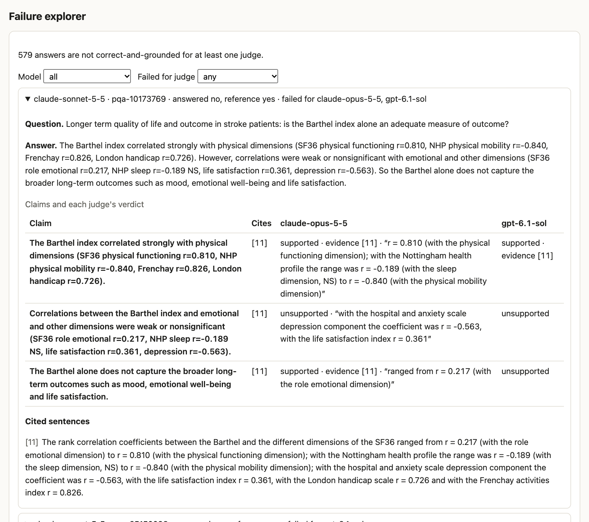
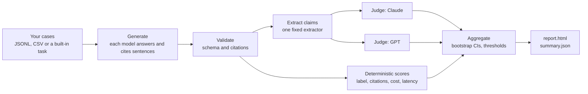

# EvalKit

[](https://pypi.org/project/evalkit-harness/)
[](https://pypi.org/project/evalkit-harness/)
[](https://github.com/biplob819/evalkit/actions/workflows/ci.yml)
[](https://github.com/biplob819/evalkit/blob/main/LICENSE)
[](https://evalkit-demo.streamlit.app/)

**Find out which model gets *your* task right, and whether its answers stick to the source.**

EvalKit runs your own cases across Claude and OpenAI models and reports, side by side, how often each model is correct, whether every claim it makes is supported by the sentences it cites, and what that costs, with confidence intervals and two judges from different model families.

**[Live demo](https://evalkit-demo.streamlit.app/)** · **[Benchmark report](https://biplob819.github.io/evalkit/)** · **[PyPI](https://pypi.org/project/evalkit-harness/)** · **[Quickstart](https://github.com/biplob819/evalkit/blob/main/docs/quickstart.md)** · **[Guides](#guides)** · **[Report a bug](https://github.com/biplob819/evalkit/issues/new/choose)**

<!-- evalkit:headline:start -->
<p align="center"></p>

On 200 PubMedQA questions, 4 models (claude-sonnet-5-5, claude-haiku-5-5, gpt-6.1-sol, gpt-6-luna) answered from the abstract and cited its sentences; two judges from different families (claude-opus-5-5 and gpt-6.1-sol) checked every claim. The most grounded model was gpt-6.1-sol, correct and fully grounded on 57.5% (95% CI 50.5%–64.0%) by claude-opus-5-5, 46.0% (95% CI 39.0%–53.0%) by gpt-6.1-sol; it is separated from every other model after a Holm correction (gpt-6.1-sol also judged its own answers; claude-opus-5-5 agrees); the most accurate model was claude-sonnet-5-5 (77.0% correct labels); the headline also requires every claim to be supported by the sentences the answer cites. Caveats: judge not calibrated for this task (see docs/calibrate-your-task.md). Treat these numbers as provisional.

[Full report](https://biplob819.github.io/evalkit/) · results in [`docs/results/`](https://github.com/biplob819/evalkit/tree/main/docs/results)

```bash
pip install 'evalkit-harness[anthropic,openai]'
evalkit init   # scaffold a project and a three-case sample task
evalkit run evalkit.yaml --task tasks/my_task.yaml --n 3 --dry-run   # estimate
evalkit run evalkit.yaml --task tasks/my_task.yaml --n 3   # needs keys in .env
```

Questions from [PubMedQA](https://pubmedqa.github.io/) (Jin et al., 2019, MIT licence); see [DATA_CARD.md](https://github.com/biplob819/evalkit/blob/main/DATA_CARD.md). Research benchmark, not medical advice.
<!-- evalkit:headline:end -->

## Why EvalKit

Public leaderboards rank models on someone else's task. The model that tops them is not always the one that answers *your* questions correctly, and a fluent answer can still say things its source never said. EvalKit measures both on your own data:

- **Accuracy:** the share of answers with the right label (yes / no / maybe, supports / refutes, or your own labels).
- **Groundedness:** each answer is split into claims, and every claim is checked against the sentences the answer cites. The headline metric is *correct and fully grounded*.
- **Citation validity, coverage, cost and latency** for every model, from the providers' own usage numbers.
- **Honest uncertainty:** 95% bootstrap confidence intervals on every rate, paired comparisons with a Holm correction, and a gap is claimed only when it survives both.
- **Judges you can check:** two judges from different families (Claude and GPT) score every claim, their self-preference is reported, and you can [calibrate them](https://github.com/biplob819/evalkit/blob/main/docs/calibrate-your-task.md) against your own hand labels.

## See it

| The report: headline chart | The report: failure explorer |
|---|---|
| [](https://biplob819.github.io/evalkit/) | [](https://biplob819.github.io/evalkit/#failures) |
| Each model's *correct and fully grounded* rate with its 95% interval, per judge, against cost. | Every answer that failed, with its claims, each judge's verdict and the sentences it cited. |

| The demo: replay mode | The demo: live mode |
|---|---|
| [](https://evalkit-demo.streamlit.app/) | [](https://evalkit-demo.streamlit.app/) |
| Four models answer one question from a study abstract; every claim is checked against what it cites. | Ask your own question about a PubMed ID or a pasted abstract (passcode required). |

## Quickstart

```bash
pip install 'evalkit-harness[anthropic,openai]'
evalkit init
evalkit run evalkit.yaml --task tasks/my_task.yaml --n 3 --dry-run
```

`evalkit init` scaffolds `evalkit.yaml`, a three-case sample task and `.env.example`. The dry run prints what a run would cost and makes no API call:

```text
dry run for my-task, 3 cases → runs/r-bded23433341
generate        claude-sonnet-5-5           3 calls  $0.0105
generate        claude-haiku-5-5            3 calls  $0.0005
generate        gpt-6.1-sol                 3 calls  $0.0105
generate        gpt-6-luna                  3 calls  $0.0005
extract_claims  claude-haiku-5-5           12 calls  $0.0036
judge           claude-opus-5-5            54 calls  $0.1242
judge           gpt-6.1-sol                54 calls  $0.0621
estimated total $0.21 (no API calls made)
```

Add your keys to `.env` (copy `.env.example`), check the setup with `evalkit doctor`, then run the same command without `--dry-run`. The run writes `report.html` and `summary.json` to its run folder. No keys yet? `evalkit report --example` renders a sample report offline.

The full walkthrough is in the [quickstart](https://github.com/biplob819/evalkit/blob/main/docs/quickstart.md). The package is `evalkit-harness` on PyPI (the name `evalkit` belongs to an unrelated project); the command and the import are both `evalkit`. Python 3.11 to 3.13 on Linux, macOS and Windows.

## How it works



- Every model call is cached by its exact inputs, so a run stopped by the cost cap, a crash or Ctrl-C resumes for free with the same command.
- Judges run on the providers' batch APIs at half price; `--live-judges` judges immediately at full price.
- A cost cap (`max_cost_usd` or `--max-cost`) is enforced before each call; the run stops with exit code 3 rather than overspend.
- Thresholds in `evalkit.yaml` make the exit code fail when a model misses the bar, so a run can gate CI.

## Guides

| Guide | What it covers |
|---|---|
| [Quickstart](https://github.com/biplob819/evalkit/blob/main/docs/quickstart.md) | Install, sample task, first result in under five minutes |
| [Write your own task](https://github.com/biplob819/evalkit/blob/main/docs/writing-a-task.md) | Your data as JSONL or CSV, prompts, labels and thresholds |
| [Control cost](https://github.com/biplob819/evalkit/blob/main/docs/cost.md) | Estimates, the cost cap, free resume, batch versus live judging, exit codes |
| [Calibrate the judges](https://github.com/biplob819/evalkit/blob/main/docs/calibrate-your-task.md) | Hand-label claims, measure judge agreement, mark a run calibrated |
| [Scorers and adapters](https://github.com/biplob819/evalkit/blob/main/docs/plugins.md) | Add a scorer or a model adapter as a plugin |
| [Run it in CI](https://github.com/biplob819/evalkit/blob/main/examples/github-action/evalkit.yml) | A GitHub Actions workflow that fails the job when a threshold fails |
| [Versioning](https://github.com/biplob819/evalkit/blob/main/docs/versioning.md) | What is public API, and how releases follow semver |

## Built-in tasks and your own data

| Task | Data | Labels |
|---|---|---|
| `pubmedqa` | [PubMedQA](https://pubmedqa.github.io/) expert-labelled questions with their abstracts | yes / no / maybe |
| `scifact` | [SciFact](https://github.com/allenai/scifact) scientific claims with evidence abstracts | supports / refutes / not enough info |
| your own | A JSONL or CSV file: question, context sentences, expected label | your label set |

Downloads are verified against pinned checksums; licences and sampling are in [DATA_CARD.md](https://github.com/biplob819/evalkit/blob/main/DATA_CARD.md).

## The live demo

**[evalkit-demo.streamlit.app](https://evalkit-demo.streamlit.app/)** shows the idea on one question at a time.

- **Replay mode** is open to everyone: prepared answers to sample PubMedQA questions, no model calls.
- **Live mode** needs a passcode from the owner, then runs either on the owner's keys (within a daily budget) or on your own Anthropic and OpenAI keys. Your keys go only into that request's API clients: never saved, never logged.
- Live requests are rate-limited per visitor and capped per request; only aggregate counts are logged, never the question or the abstract.

The demo's source is in [`demo/`](https://github.com/biplob819/evalkit/tree/main/demo).

## Results

The first benchmark (200 PubMedQA questions, four models, two judges) is in the [full report](https://biplob819.github.io/evalkit/), with the raw summary in [`docs/results/`](https://github.com/biplob819/evalkit/tree/main/docs/results). The judges are not yet calibrated for that task, so treat those numbers as provisional.

## Project documents

- [Product requirements](https://github.com/biplob819/evalkit/blob/main/EvalKit%20PRD.md) and [technical spec](https://github.com/biplob819/evalkit/blob/main/EvalKit%20Tech%20Spec.md)
- [Design decisions](https://github.com/biplob819/evalkit/blob/main/docs/decisions.md), [lessons learned](https://github.com/biplob819/evalkit/blob/main/docs/lessons.md) and the [changelog](https://github.com/biplob819/evalkit/blob/main/changelog.md)
- Build status: `uv run python scripts/status.py` (the project was built node by node, each verified against written criteria and an independent reviewer)

## Contributing, security and privacy

- **No telemetry.** Data goes only to the model providers you configure: [PRIVACY.md](https://github.com/biplob819/evalkit/blob/main/PRIVACY.md).
- **Security:** key handling and how to report a vulnerability privately: [SECURITY.md](https://github.com/biplob819/evalkit/blob/main/SECURITY.md).
- **Contributing:** set-up, checks and conventions in [CONTRIBUTING.md](https://github.com/biplob819/evalkit/blob/main/CONTRIBUTING.md); please follow the [code of conduct](https://github.com/biplob819/evalkit/blob/main/CODE_OF_CONDUCT.md). Bug reports and ideas: [open an issue](https://github.com/biplob819/evalkit/issues/new/choose).
- To work on EvalKit itself: clone the repository and run `uv sync --all-extras`.

## Credits and licence

Questions from PubMedQA (Jin et al., 2019, MIT licence) and claims from SciFact (Wadden et al., 2020); see [DATA_CARD.md](https://github.com/biplob819/evalkit/blob/main/DATA_CARD.md). EvalKit is a research tool, not medical advice.

MIT licence. See [LICENSE](https://github.com/biplob819/evalkit/blob/main/LICENSE).
